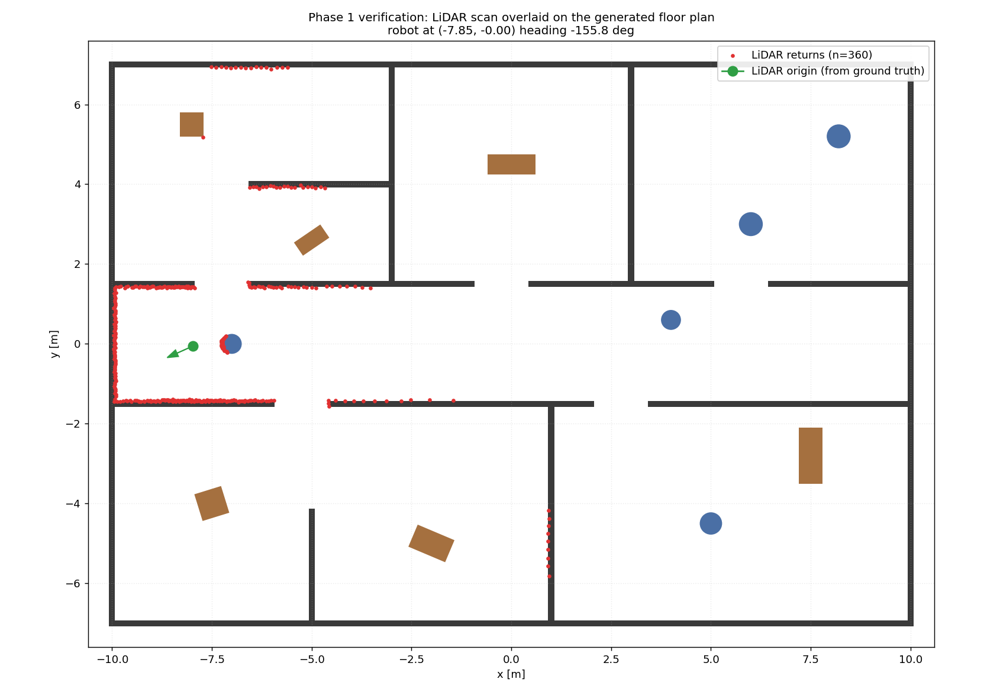
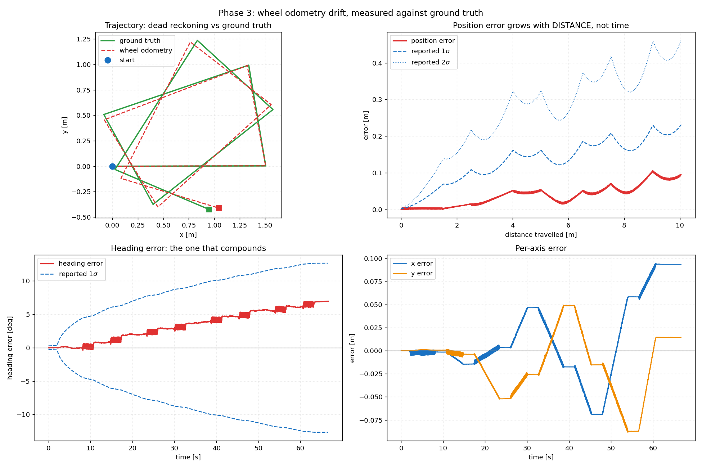
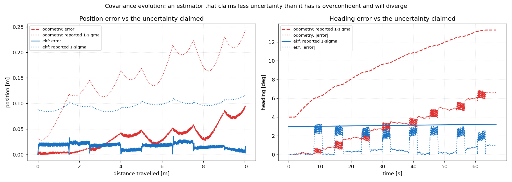

# Autonomous Robot Brain

A miniature autonomous-vehicle software stack: a differential-drive robot in
Gazebo estimates its own pose from noisy IMU, wheel-encoder and 2D LiDAR data,
maps its surroundings, plans a collision-free route to a goal, and keeps doing
so while its sensors are deliberately degraded and failed.

> **Project status: Phases 0-5 of 12 complete and verified.**
> A six-state EKF fuses wheel odometry with the IMU gyroscope, estimating the
> gyro bias online. Measured against ground truth over a 10 m route it cuts
> position RMSE by **68 %** and heading RMSE by **61 %** against wheel odometry
> alone, ending 0.13 % of distance travelled from the true pose.
> 133 unit tests and 90 integration tests pass. Mapping (Phase 6) is next. See
> [Verification status](#verification-status) for exactly what has been run.

---

## Problem statement

Indoors there is no GPS. A robot's only sense of position comes from integrating
its own motion, which drifts without bound, and from recognising places in a map
it built itself, which makes the error self-referential. On top of that, real
sensors do not fail cleanly — they get noisier, they develop slow biases, they
drop measurements, and occasionally they stop entirely.

This project asks a narrow, measurable question:

> **How much sensor degradation can a well-built EKF-based localisation stack
> absorb before the robot can no longer reach its goal — and which failure modes
> hurt most?**

Everything in the repository exists to answer that with numbers rather than a
demo video.

---

## Architecture

```
Sensors ─▶ Preprocessing ─▶ State Estimation ─▶ Localization
                                   │
            Mapping ◀──────────────┤
               │                   │
        Path Planning ─▶ Local Avoidance ─▶ Controller ─▶ Robot Motion
```

Full diagram, package decomposition, frame conventions, topic contract and QoS
policy: **[docs/architecture.md](docs/architecture.md)**.

| Package | Responsibility | Phase |
|---|---|---|
| `arb_core` | Header-only math: angle algebra, `Pose2D` (SE(2)) | 0 |
| `arb_msgs` | `EkfDiagnostics`, `FaultState`, `PlannerMetrics` | 0 |
| `arb_description` | URDF/xacro robot model, RViz config | 1 |
| `arb_simulation` | Gazebo worlds, `ros_gz` bridge | 1 |
| `arb_sensors` | Preprocessing, noise model, fault injection | 2, 10 |
| `arb_localization` | Wheel odometry, EKF, LiDAR scan matching | 3, 4 |
| `arb_mapping` | Occupancy grid, log-odds fusion | 6 |
| `arb_planning` | A*, Dijkstra, Dynamic Window Approach | 7, 8 |
| `arb_control` | PID trajectory tracking | 9 |
| `arb_bringup` | Top-level launch composition | 1+ |
| `arb_evaluation` | Metrics, plots, benchmark reports (Python) | 5, 11 |

### One rule worth stating up front

Gazebo knows the robot's exact pose. That pose is published on
`/arb/ground_truth/pose` and is **evaluation-only**. No estimation, mapping,
planning or control node may subscribe to it. The rule is enforced mechanically
by [`tests/integration/test_ground_truth_isolation.py`](tests/integration/test_ground_truth_isolation.py),
which greps the estimation packages and also inspects the live node graph.

An estimator that secretly reads ground truth produces a flawless plot and a
meaningless result. The check exists because that failure is silent.

---

## Installation

Validated target: **Ubuntu 24.04 LTS** + **ROS 2 Jazzy Jalisco** +
**Gazebo Harmonic**.

Those three are the officially paired Tier-1 combination for Noble. Jazzy is
supported until May 2029; Gazebo Classic reached end of life in January 2025 and
is deliberately not used.

```bash
# 1. Toolchain
sudo apt update && sudo apt install -y \
  build-essential cmake git python3-pip python3-venv libeigen3-dev \
  curl gnupg lsb-release software-properties-common

# 2. ROS 2 apt repository
sudo add-apt-repository -y universe
sudo curl -sSL https://raw.githubusercontent.com/ros/rosdistro/master/ros.key \
  -o /usr/share/keyrings/ros-archive-keyring.gpg
echo "deb [arch=$(dpkg --print-architecture) signed-by=/usr/share/keyrings/ros-archive-keyring.gpg] \
http://packages.ros.org/ros2/ubuntu $(. /etc/os-release && echo $UBUNTU_CODENAME) main" \
  | sudo tee /etc/apt/sources.list.d/ros2.list > /dev/null
sudo apt update

# 3. ROS 2 Jazzy + Gazebo Harmonic + analysis stack
sudo apt install -y \
  ros-jazzy-desktop ros-dev-tools ros-jazzy-ros-gz \
  ros-jazzy-tf-transformations python3-colcon-common-extensions \
  python3-numpy python3-matplotlib python3-scipy python3-pytest python3-pandas

# 4. rosdep
sudo rosdep init 2>/dev/null; rosdep update
```

Verify:

```bash
./scripts/check_environment.sh
```

A Docker environment is provided for CI and cross-machine reproducibility; see
[docker/README.md](docker/README.md). Native install is the recommended
development path because Gazebo and RViz both want direct GPU and X11 access.

---

## Known environment pitfalls

**The workspace path must be ASCII-only.** ROS 2's `rosidl` CMake code splits
interface paths on non-ASCII bytes. A workspace under, say, the Turkish desktop
folder `~/Masaüstü/` fails with a message that names a path which does not
exist:

```
CMake Error ... Target dependency '/home/user/Masa' does not exist
CMake Error ... list index: 1 out of range (-1, 0)
```

Nothing in that error mentions encoding, which makes it expensive to diagnose.
This repository therefore lives at an ASCII path and both
`scripts/check_environment.sh` and `scripts/build.sh` refuse to run if the
resolved workspace path contains non-ASCII characters. The build scripts use
`pwd -P` so the build still works when the repo is reached through a symlink
placed in a non-ASCII directory.

**ROS setup scripts are incompatible with `set -u`.** `/opt/ros/jazzy/setup.bash`
dereferences `AMENT_TRACE_SETUP_FILES` before defining it, so any script with
`set -euo pipefail` aborts on `source`. All scripts here use `set -eo pipefail`.

---

## Build and test

```bash
./scripts/build.sh          # colcon build (Release)
./scripts/run_tests.sh      # all unit tests + summary
pytest tests/integration -v # architecture guards
```

---

## Usage

```bash
source /opt/ros/jazzy/setup.bash
source ros2_ws/install/setup.bash

# Simulation with GUI and RViz
ros2 launch arb_simulation simulation.launch.py

# Headless, for batch experiments
ros2 launch arb_simulation simulation.launch.py headless:=true rviz:=false

# Spawn somewhere else (names come from configs/world.yaml)
ros2 launch arb_simulation simulation.launch.py spawn:=goal_room_c
```

Drive it by hand:

```bash
ros2 run teleop_twist_keyboard teleop_twist_keyboard
```

Verify the simulation is actually producing usable data (rates, frame ids,
noise, beam geometry, and an open-loop motion check):

```bash
python3 scripts/verify_simulation.py
```

Overlay a live scan on the known floor plan:

```bash
python3 scripts/plot_scan_vs_world.py -o results/phase1/scan_vs_world.png
```

Bring up the sensor preprocessing layer, and verify it:

```bash
ros2 launch arb_sensors sensors.launch.py
python3 scripts/verify_sensors.py
```

Inject a fault at runtime, with the stack running:

```bash
ros2 param set /imu_preprocessor fault.noise_scale 10.0
```

```bash
ros2 param set /encoder_preprocessor fault.right_bias_rad_s 0.05
```

```bash
ros2 param set /lidar_preprocessor fault.dropout_ratio 0.6
```

Bring up wheel odometry, measure its drift, and recalibrate it:

```bash
ros2 launch arb_localization odometry.launch.py
```

```bash
python3 scripts/evaluate_odometry.py
```

```bash
python3 scripts/calibrate_odometry.py
```

Compare every estimator against ground truth and write the Phase 5 plots:

```bash
python3 scripts/evaluate_localization.py --tag nominal
```

Run the odometry alone, as the baseline the filter is measured against:

```bash
ros2 launch arb_localization odometry.launch.py ekf:=false
```

Regenerate the world after editing `configs/world.yaml`:

```bash
python3 scripts/generate_world.py
```

### Simulation



A live 360-beam LiDAR scan (red) plotted over the floor plan the world was
generated from. Every beam is placed using the sensor extrinsics from
`configs/robot.yaml` and the robot's ground-truth pose. Agreement between the
red points and the black walls exercises the whole chain at once: world
generation, physics, GPU LiDAR, beam indexing, sensor mounting and the
`ros_gz` bridge.

Measured residual of each beam endpoint to the nearest modelled surface:

| Statistic | Value |
|---|---|
| Mean | -0.0007 m |
| Median | -0.0006 m |
| Standard deviation | **0.0149 m** |
| Configured LiDAR noise sigma | **0.015 m** |
| Beams within 5 cm of a surface | 99.7 % |
| Beams used | 360 / 360 |

The residual spread equals the configured measurement noise, so the geometric
pipeline contributes no bias and no additional error.

### Sensor preprocessing

`arb_sensors` turns the simulator's idealised output into something the
corresponding hardware could actually have produced, and is the single place
faults are injected.

| Stage | What it models |
|---|---|
| IMU | Gauss-Markov bias (exact Ornstein-Uhlenbeck update), scale error, startup bias calibration, honest covariance, `orientation_covariance[0] = -1` to declare that this is not an AHRS |
| Encoders | Quadrature quantisation (1024x4 counts/rev = 1.534 mrad = 0.092 mm of arc), velocity by differencing counts, per-wheel slip and injectable drift |
| LiDAR | One sentinel for every unmeasurable beam, geometric despeckling, range noise, per-beam and bursty dropout |

Three properties are worth calling out, because each was a bug first:

* **Noise is not double-counted.** Gazebo already applies the datasheet noise.
  Adding another full sigma combines as `sqrt(2) * sigma`, making the stream
  41 % noisier than the part being simulated and every published covariance
  wrong by the same factor. Independent variances add, so this stage injects
  only `sqrt((scale*sigma)^2 - sigma^2)` -- exactly zero at nominal.
* **Degrading a sensor widens its reported covariance.** A fault that worsens
  the data without telling the filter teaches it nothing; the EKF keeps
  trusting a sensor that has failed.
* **The fault knob is calibrated.** Despeckling runs before dropout, because
  with it afterwards a commanded 60 % beam loss measured 75.5 %: most survivors
  of a random 60 % cull have no surviving neighbour, so the filter removed them
  too.

### Odometry

`arb_localization/wheel_odometry` integrates the preprocessed encoders and
publishes `nav_msgs/Odometry` plus the `odom -> base_link` transform. It uses
the **exact** SE(2) arc update rather than forward Euler:

```
x     += v dt * sinc(a/2) * cos(theta + a/2)      a = omega * dt
y     += v dt * sinc(a/2) * sin(theta + a/2)      sinc(u) = sin(u)/u
theta += a
```

No singularity at `omega = 0`, midpoint heading, and `sinc` is the chord-to-arc
ratio. Both covariance Jacobians are verified against central finite
differences.

**The effective track width is a calibration parameter, not a measurement.**
A cylindrical wheel touches the floor along a line, and the traction that turns
the robot does not act at the wheel's centre plane. Measured effective width:
**0.3154 m** against a geometric 0.350 m — the distance between the wheels'
inner edges, to within a millimetre.

| Metric over a 10 m route | Geometric `L` | Calibrated `L` |
|---|---|---|
| Final position error | 0.989 m (9.86 %) | **0.095 m (0.94 %)** |
| Final heading error | −72.36° | **6.96°** |
| RMS position error | 0.540 m | **0.055 m** |



The heading error is a staircase: it steps at every turn and is flat on every
straight. That residual is what Phase 4 exists to bound.

### State estimation

A six-state EKF, `[x, y, theta, v, omega, b_gyro]`, fusing the wheel odometry
twist with the IMU gyroscope.

`v` and `omega` are **states rather than control inputs** because two
independent sensors measure them, and that is what lets the filter fuse both
opinions. `b_gyro` is observable for the same reason: the encoders measure
`omega` independently, so the persistent gap between gyro and encoders *is* the
bias. `v_y` is deliberately absent — a differential drive cannot translate
sideways, and an unobservable state is not free.

Measured over 10.03 m, two laps of a rectangle:

| Metric | Wheel odometry | EKF | Change |
|---|---|---|---|
| Position RMSE | 0.0486 m | **0.0155 m** | **−68.0 %** |
| Final position error | 0.0946 m (0.94 %) | **0.0134 m (0.13 %)** | −86 % |
| Heading RMSE | 3.631° | **1.432°** | **−60.6 %** |
| Final heading error | +6.626° | **+0.977°** | −85 % |
| Samples inside reported 2σ | 100 % | 100 % | — |

Estimation latency: median 55 ms — the cost of the timestamp-ordered
measurement buffer that lets a 200 Hz IMU and a 50 Hz encoder stream be fused
in order.



The odometry's error and its claimed uncertainty both grow without bound; the
EKF's error stays flat. The gyro bounds the *rate* at which heading uncertainty
accumulates, not the position error itself — that needs an absolute measurement,
which arrives in Phase 6 when there is a map to match scans against.

### Topic graph

```
            gz sim (physics + sensors)
                      |  gz-transport, NOT DDS
              ros_gz_bridge   <- config: arb_simulation/config/ros_gz_bridge.yaml
                      |  ROS 2 DDS
  /clock      /imu/data_raw     /joint_states      /scan_raw
  1000 Hz        200 Hz             50 Hz            10 Hz

  /arb/ground_truth/odom  100 Hz   <- EVALUATION ONLY

  /cmd_vel  --(ROS to GZ)-->  DiffDrive plugin  -->  wheel torques
  /robot_description  -->  robot_state_publisher  -->  /tf, /tf_static

                            arb_sensors
  /imu/data_raw   -->  imu_preprocessor      -->  /arb/imu           200 Hz
  /joint_states   -->  encoder_preprocessor  -->  /arb/wheel_states   50 Hz
  /scan_raw       -->  lidar_preprocessor    -->  /arb/scan           10 Hz

                            arb_localization
  /arb/wheel_states  -->  wheel_odometry  -->  /arb/odom           50 Hz
                                          -->  TF odom->base_link

  /arb/odom  +  /arb/imu  -->  ekf  -->  /arb/pose            50 Hz
                                    -->  /ekf/diagnostics     50 Hz
                                    -->  TF map->odom
```

Gazebo and ROS 2 run on separate middlewares. A sensor that is configured
perfectly in the URDF but absent from the bridge config publishes happily
inside Gazebo and is completely invisible to ROS, which looks identical to a
broken sensor.

---

## Configuration

No magic numbers in source. Everything numeric lives in YAML:

| File | Contents |
|---|---|
| [`configs/robot.yaml`](configs/robot.yaml) | Physical geometry, wheel radius/separation, actuator limits, sensor extrinsics |
| [`configs/sensors.yaml`](configs/sensors.yaml) | Nominal sensor specs and the noise model (noise density, bias stability, random walk) |
| [`configs/scenarios/*.yaml`](configs/scenarios/) | The six fault-injection scenarios (Cases A–F) |
| `ros2_ws/src/<pkg>/config/` | Per-node ROS parameters |

`configs/robot.yaml` is the single source of truth for geometry. A mismatch
between the simulated wheel radius and the one used by the odometry equations
produces a systematic scale error that looks exactly like sensor drift — one of
the hardest bugs in this whole project to find after the fact.

---

## Fault-injection scenarios

| Case | Scenario | What it tests |
|---|---|---|
| A | Nominal | Baseline every other case is measured against |
| B | IMU noise ×10 | Does the filter down-weight a degraded sensor, or blindly trust it? |
| C | Wheel encoder drift | A one-wheel bias is indistinguishable from a real turn using encoders alone |
| D | LiDAR beam dropout (60 %, bursty) | Does the NIS chi-square gate reject bad scan matches? |
| E | Total sensor outage (10 s) | Does the filter keep predicting and re-converge, or freeze/diverge? |
| F | Multiple simultaneous degradation | Compounding faults — the interesting case |

---

## Results

> Populated from Phase 5 onwards. Trajectory comparisons, per-axis error traces,
> covariance evolution, planner benchmarks and the fault-injection comparison
> table will be written to `results/` and summarised here.

---

## Verification status

This project distinguishes between *written* and *verified*. Nothing is claimed
to work until it has been executed.

| Item | Status | Evidence |
|---|---|---|
| Environment (ROS 2 Jazzy, Gazebo Sim 8.15.0, g++ 13.3, CMake 3.28, Eigen 3.4) | ✅ verified | `./scripts/check_environment.sh` → *Environment OK* |
| `colcon build` | ✅ verified | 11/11 packages, zero stderr |
| Unit tests (`colcon test`) | ✅ verified | **133 tests, 0 failures** |
| Integration tests (`pytest tests/integration`) | ✅ verified | **90 passed, 1 skipped** |
| Unit tests are not vacuous | ✅ verified | 23 deliberate mutations injected across three packages; all caught (6 escaped first and the tests were strengthened) |
| Ground-truth isolation guard | ✅ verified | passes, and fails correctly when a violation is injected |
| URDF matches `configs/robot.yaml` | ✅ verified | every dimension compared in `test_urdf_model.py` |
| Node params match the repo config | ✅ verified | `test_config_consistency.py` (caught one real drift) |
| Robot spawns, drives, rests level | ✅ verified | pitch 0.000000 rad, z 0.100000 m |
| Scan matches floor plan | ✅ verified | residual sigma 0.0149 m vs 0.015 m configured noise |
| Preprocessed stream rates | ✅ verified | 200.00 / 50.00 / 10.00 Hz measured |
| Runtime fault injection changes the data | ✅ verified | `noise_scale=10` → 9.7x spread, covariance 100x |
| Odometry integrates a circle exactly | ✅ verified | full circle closes to 1e-9 m, independent of step size |
| Odometry + EKF Jacobians match finite differences | ✅ verified | central differences, 1e-5 tolerance |
| Track width calibration | ✅ verified | 0.3500 → 0.3154 m, direction asymmetry 0.00 % |
| Odometry drift | ✅ measured | 0.0946 m over 10.03 m = **0.94 %** of distance |
| EKF drift | ✅ measured | 0.0134 m over 10.03 m = **0.13 %** of distance |
| EKF improves on odometry | ✅ measured | position RMSE **−68.0 %**, heading RMSE **−60.6 %** |
| EKF covariance is consistent | ✅ verified | 100 % of samples inside the reported 2σ; average NIS 2.0 ± 0.15 against 2 dof |
| Gyro bias is observable and estimated | ✅ verified | converges to a 0.03 rad/s injected bias within 0.004 |
| Both sensor streams are actually fused | ✅ verified | 467/470 odometry and 1833/1845 IMU measurements fused, 0 out of order |
| Estimation latency | ✅ measured | median 55 ms, p95 60 ms, max 70 ms |
| LiDAR absolute correction | ❌ not implemented | Phase 6 — there is no map to match against yet |
| Mapping, planning, control | ❌ not implemented | Phases 6-9 |
| Fault scenario timeline (Cases A-F) | ❌ not implemented | Phase 10 — the runtime knobs exist, the scheduler does not |


---

## Limitations

- Localisation is 2D (SE(2)). Slopes, ramps and non-planar motion are out of scope.
- Mapping is a static occupancy grid, not full SLAM — there is no loop closure
  and no pose-graph optimisation, so long traverses accumulate map error.
- The Gazebo sensor models are idealised approximations of real hardware;
  absolute error figures are meaningful *relative to each other*, not as
  predictions of real-world performance.
- On this hybrid Intel/NVIDIA machine Gazebo logs `libEGL warning: egl: failed
  to create dri2 screen` at startup. The GPU LiDAR still produces correct data
  at the full 10 Hz (verified), but rendering falls back to a slower path.

---

## Future improvements

- Replace the EKF with an Unscented or Invariant EKF and compare consistency (NEES).
- Graph-based SLAM with loop closure instead of a static grid.
- MPC in place of PID for trajectory tracking.
- Hardware validation on a physical differential-drive platform.

---

## Learning notes

Turkish-language notes explaining the reasoning behind each phase live in
[`docs/learning-notes/`](docs/learning-notes/).

## License

MIT — see [LICENSE](LICENSE).
