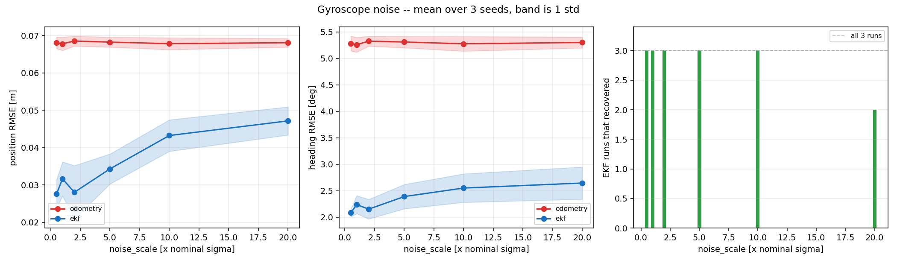
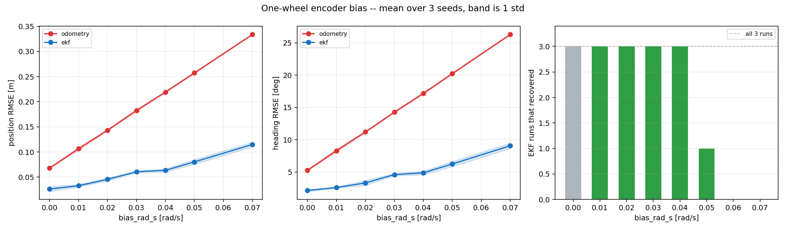
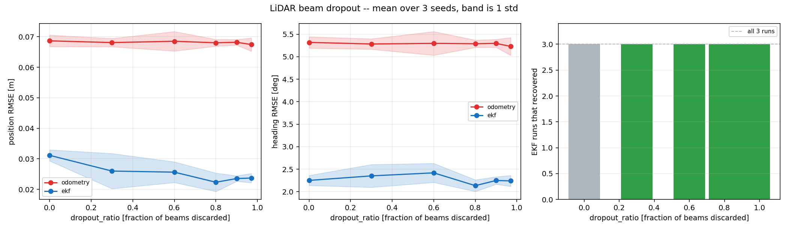
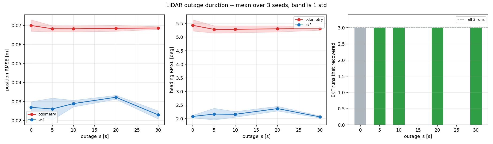

# Benchmarks

Phase 11. Five experiments, each sweeping **one** parameter across a range and
**repeated over seeds**.

Every number here comes from `results/phase11/` and is reproducible with
`scripts/run_benchmark.py` and `scripts/run_navigation_benchmark.py`.

---

## 1. What this phase is for

Phase 10 ran each failure mode **once, at one magnitude**. That answers "does
this failure mode do what the theory says". It cannot answer either of the two
questions that matter next:

* **How much can the estimator take?** A single point on a response curve does
  not tell you where the curve bends.
* **Is that an effect or is it noise?** Phase 10's Case A came out at 76 %
  covariance consistency and Case D at 92 %, and the difference was that they
  were different runs.

So: one parameter at a time, swept across a range, every point repeated over
three seeds, reported as a mean with a spread.

### The spread is a standard deviation, not a standard error

`±` throughout is the **population standard deviation over the repeats** —
how much the three runs differed from each other. It is deliberately not a
standard error or a confidence interval: three samples cannot support one, and
printing `± 0.002` as though it bounded the true mean would claim a precision
that is not there.

**Three repeats is few.** It is enough to see whether an effect is larger than
the scatter and not enough to say anything about a tail.

### Not comparable with Phase 10's numbers

These runs are 75 s where Phase 10's were 120 s. A dead-reckoning error grows
with **distance travelled**, so every absolute figure here is smaller. Within a
sweep the comparison is sound, because every run uses the same duration.

---

## 2. How one run works

```
fresh simulator -> fresh EKF -> fresh map -> fixed open-loop route
  -> one fault at one magnitude -> score against ground truth
```

The route is the rectangle Phase 5 and Phase 10 used, driven by **timed
velocity commands**. Faults are injected in the preprocessing layer, downstream
of the simulator, so the wheels receive identical commands and **the true
trajectory is the same in every run of a sweep**. Any difference in the result
is estimation error. See [fault-injection.md](fault-injection.md) section 1.

### Everything restarts between runs

Cheaper options were considered and are all wrong:

* Restarting only the sensor nodes leaves the **EKF holding the previous run's
  state** and the **mapping node holding the previous run's map**, so run N
  inherits run N-1's error — exactly the contamination the fault scheduler
  goes out of its way to avoid *within* a run.
* Seeds cannot be changed at runtime at all. The noise generators are
  constructed with their seed, and the nodes **reject** the attempt rather than
  let the parameter server disagree with the running model.

So each repeat relaunches with an overridden parameter file. The three sensor
seeds are **offset separately**, not set to a common value: giving the gyro and
the encoders the same seed correlates their noise streams, and a robot whose
gyro noise and wheel noise move together is a physically different robot from
the one every other phase measured.

---

## 3. A bug this phase found before it ran

The gyro sweep runs from **0.5x** to 20x nominal noise, deliberately covering
both ends of the response. The low end measured nothing.

`knobs_at` composed every fault against the current knob set with
`max(current, requested)`, starting from nominal. That rule exists to resolve
**two overlapping faults** — Case F's whole point — and applied between a fault
and the baseline it silently clamps anything asking for *less* than nominal:

```
max(1.0, 0.5)  ==  1.0
```

Six runs at half the datasheet noise would have measured the healthy robot and
produced a flat line at the left of every plot, which is exactly what a
diminishing-returns curve looks like. Nothing would have flagged it.

Found by generating the sweep's scenarios and **reading them before running
them**, which is worth more than two hours of simulation: a wrong number is
easier to spot in a dictionary than in a graph.

Faults now write a knob on first touch and compose only with **each other**.
The two properties pull in opposite directions, so they are tested as a pair —
one says "do not compose against nominal", the other "do compose against
another fault" — and a fix for either that broke the other would otherwise
pass.

---

## 4. Results

The generated tables and plots live in
[`results/phase11/benchmark_report.md`](../results/phase11/benchmark_report.md),
regenerated from the per-run metrics with:

```bash
python3 scripts/run_benchmark.py --aggregate-only
```

What follows is the reading of them, one experiment at a time. The per-run
JSONs under `results/phase11/raw/` are the record; the tables are a view of
them, and `--aggregate-only` re-derives every one without touching the
simulator.

---

## 4a. The filter barely notices gyro noise, and that is the point



| noise x nominal | EKF pos RMSE [m] | odom pos RMSE [m] | EKF/odom | EKF heading RMSE [deg] | inside 2-sigma |
|---|---|---|---|---|---|
| 0.5 | 0.0276 ± 0.0039 | 0.0681 ± 0.0016 | 2.46x | 2.08 ± 0.07 | 93 % |
| 1 | 0.0316 ± 0.0046 | 0.0678 ± 0.0018 | 2.14x | 2.24 ± 0.17 | 89 % |
| 2 | 0.0280 ± 0.0071 | 0.0685 ± 0.0013 | 2.44x | 2.15 ± 0.18 | 93 % |
| 5 | 0.0343 ± 0.0040 | 0.0682 ± 0.0013 | 1.99x | 2.39 ± 0.23 | 86 % |
| 10 | 0.0432 ± 0.0042 | 0.0678 ± 0.0016 | 1.57x | 2.55 ± 0.27 | 85 % |
| 20 | 0.0471 ± 0.0038 | 0.0681 ± 0.0011 | 1.44x | 2.64 ± 0.30 | 82 % |

**A 40x change in gyro noise produces a 1.7x change in position error.** That
is the Phase 10 Case B question — "does the filter down-weight a degraded
sensor, or blindly trust it?" — answered with a curve instead of a point. It
down-weights, and very effectively: the preprocessor widens the reported
covariance along with the noise, the EKF believes the gyro less, and it leans
on the encoders, which measure the same angular rate independently.

That redundancy is the whole reason `ω` is a *state* rather than an input. A
filter that took wheel odometry as a control input would have nothing to fall
back on here.

### Below 5x, buying a better gyro buys nothing

0.5x, 1x and 2x come out at 0.0276, 0.0316 and 0.0280 m — **non-monotonic and
inside the spread**. Halving the gyro noise is not measurably better than
nominal, because the gyro is not the limiting factor. The scan matcher and the
map are.

As an engineering conclusion that is worth more than the degradation curve:
*for this robot, on this route, a quieter IMU is wasted money.*

### The odometry column proves the experiment works

Wheel odometry does not consume the IMU, and its error is flat across the whole
sweep — 0.0678 to 0.0685 m, a span of 1 %. Its run-to-run spread is **±2 %**.

Two things follow. The control behaves exactly as a control should, so the
setup is measuring what it claims to. And since the EKF's spread is **±15 %**
against odometry's ±2 %, the EKF's variability is **not coming from the
sensors** — it comes from the mapping and scan-matching loop, which is the same
mechanism that produces the encoder-bias threshold below.

---

## 4b. The encoder-bias threshold is real

Phase 10 left a hypothesis it could not test. Case C (0.05 rad/s) never
recovered; Case F (0.04 rad/s) recovered in 1.4 s. Two variables differed
between those runs and each was a single sample, so it was written up as "the
experiment Phase 11 should run". This is that experiment, and the hypothesis
survives.



| bias [rad/s] | EKF pos RMSE [m] | odom pos RMSE [m] | EKF recovered | inside 2-sigma |
|---|---|---|---|---|
| 0 | 0.0262 ± 0.0051 | 0.0680 ± 0.0011 | n/a | 97 % |
| 0.01 | 0.0328 ± 0.0027 | 0.1064 ± 0.0032 | 3 / 3 | 92 % |
| 0.02 | 0.0455 ± 0.0030 | 0.1433 ± 0.0016 | 3 / 3 | 82 % |
| 0.03 | 0.0605 ± 0.0020 | 0.1827 ± 0.0023 | 3 / 3 | 68 % |
| 0.04 | 0.0635 ± 0.0034 | 0.2193 ± 0.0015 | 3 / 3 | 67 % |
| **0.05** | 0.0803 ± 0.0049 | 0.2575 ± 0.0016 | **1 / 3** | 60 % |
| 0.07 | 0.1149 ± 0.0048 | 0.3338 ± 0.0011 | **0 / 3** | 45 % |

Per-seed, the transition is sharper than the summary suggests:

```
0.01 - 0.03   never left the band          3/3   the fault is absorbed entirely
0.04          never left 2/3, recovered 1/3      the transition begins
0.05          recovered 1/3, did not 2/3         the threshold
0.07          did not recover              3/3
```

**There is a recovery threshold, and it sits between 0.04 and 0.05 rad/s** for
this route and this fault duration. Phase 10's two single runs both fall
exactly where the sweep says they should — Case C at 0.05 landing in the 2/3
that fail, Case F at 0.04 in the 3/3 that recover.

A level that comes out 1/3 is what a threshold looks like from three samples:
not a clean edge, but the point where the outcome becomes **seed-dependent**.
Where exactly it sits is not established — three seeds locate a transition
between two levels, not within one.

### The covariance consistency is the cleanest result in the project

Look at the last column. It falls **monotonically, 97 % to 45 %**, across a
sweep in which nothing about the filter changed.

This is the self-referential map quantified. As the bias grows, the drift grows
with it, and the map — built at the EKF's own estimated pose — drifts along.
Scan matching against that map keeps returning small corrections at high
scores, so the filter's reported covariance stays tight while its actual error
grows. The more **systematic** the error, the more confidently wrong the filter
becomes.

A filter whose error grows while its covariance does not is worse than a bad
filter, because everything downstream believes it. That is not visible in a
position RMSE column, which grows smoothly and unremarkably across the same
sweep.

### The spreads say these are effects, not noise

`±` at the control level is 0.0051 m on 0.0262 m — **±19 % scatter between
runs at identical conditions**. Every difference in the table above is several
times that. It also settles a Phase 10 loose end: the 76 %-vs-92 % covariance
gap between Case A and Case D there was run-to-run variation, exactly as
suspected.

---

## 4c. Eleven beams are enough

Phase 10's Case D dropped 60 % of the LiDAR beams and came out indistinguishable
from nominal, which was written up as "the scenario is not stressful" rather
than as a pass. This pushes it to 97 %.



| dropout | beams surviving | EKF pos RMSE [m] | EKF heading RMSE [deg] | inside 2-sigma |
|---|---|---|---|---|
| 0 | 360 | 0.0311 ± 0.0018 | 2.25 ± 0.11 | 89 % |
| 0.3 | 252 | 0.0260 ± 0.0058 | 2.35 ± 0.25 | 93 % |
| 0.6 | 144 | 0.0256 ± 0.0034 | 2.42 ± 0.21 | 95 % |
| 0.8 | 72 | 0.0223 ± 0.0030 | 2.14 ± 0.13 | 100 % |
| 0.9 | 36 | 0.0235 ± 0.0009 | 2.25 ± 0.08 | 98 % |
| 0.97 | **11** | 0.0237 ± 0.0015 | 2.24 ± 0.12 | 99 % |

**Throwing away 97 % of the LiDAR does not degrade the estimate.** Not
slightly — not at all.

### The fault really was applied

A null result invites the suspicion that nothing happened, so: at 0.97 the
preprocessor logged **139,546 beams dropped**, against the 139,680 predicted by
400 scans x 360 beams x 0.97. And the scan matcher kept working on what was
left — `92 accepted / 94 attempted` across the whole run, scoring 0.98.

### Why this is not surprising once you count

Eleven range returns spread around a full circle **over-determine** a 3-DOF
pose in a closed rectangular room. Scan matching against a likelihood field
does not need correspondences or features; it needs enough rays to pin down
`x`, `y` and `θ`, and three would do it in principle. At 360 beams the problem
is over-determined by two orders of magnitude.

The useful engineering conclusion is the inverse of the obvious one: **this
stack's LiDAR is massively over-specified for localisation in this
environment.** What the extra beams buy is the *map* — occupancy grid coverage
and resolution — not the pose.

### The slight improvement is real but unexplained

The trend is mildly *favourable*: 0.0311 m at no dropout against 0.0237 m at
97 %, and covariance consistency rising from 89 % to 99 %. The difference is
two to three times the run-to-run spread and consistent across every level, so
it is unlikely to be noise.

The mechanism is **not established**. A plausible one: adjacent beams hitting
the same wall are strongly correlated, the matcher treats them as independent,
and 360 of them therefore produce an over-confident match that the EKF then
over-trusts. Fewer, sparser beams would be closer to genuinely independent and
the reported covariance closer to honest — which is what the last column looks
like. Another: fewer rays integrated per scan means less reinforcement of the
current estimate in a map built at that estimate.

Both are stories that fit. Distinguishing them needs an experiment this sweep
does not contain, and it is written here as an open question rather than a
finding.

### And a limitation that matters more than the result

This is a **closed 20 x 14 m room with structure in every direction**. A
corridor with two blank parallel walls constrains one axis and leaves the other
free, and eleven beams there would be nowhere near enough. The number 11 is not
transferable; the reasoning — count the constraints against the degrees of
freedom — is.

---

## 4d. Thirty seconds without an absolute reference costs a centimetre

The LiDAR is the **only absolute** measurement in the stack. Everything else is
a rate, and rates only say how much things have changed. This sweeps how long
the filter can go without one.



| outage [s] | EKF pos RMSE [m] | degraded-phase RMSE [m] | recovered | inside 2-sigma |
|---|---|---|---|---|
| 0 | 0.0269 ± 0.0030 | -- | n/a | 95 % |
| 5 | 0.0261 ± 0.0057 | 0.0226 | 3 / 3 | 98 % |
| 10 | 0.0289 ± 0.0017 | 0.0190 | 3 / 3 | 92 % |
| 20 | 0.0322 ± 0.0010 | 0.0211 | 3 / 3 | 93 % |
| 30 | 0.0230 ± 0.0021 | 0.0216 | 3 / 3 | 99 % |

Every run recovers, and the whole-run RMSE does not move outside the spread.
The degraded-phase column rises monotonically from 10 s onwards — 0.0190,
0.0211, 0.0216 — which is the effect, and it is about **2 mm**.

### The outage is real; this was checked

A second null result in the same phase deserves more suspicion than the first,
so the knob was exercised against a live stack and the scan matcher counted
directly:

```
outage ON,  20 s elapsed:   0 new matches attempted
outage OFF, 20 s elapsed:  23 new matches attempted
```

Scan matching stops completely. The preprocessor logged 213 scans dropped over
the same window.

### Why it costs so little, in a number from Phase 4

During an outage the EKF is not on raw wheel odometry — it is on **odometry
fused with the gyroscope**, which Phase 4 measured at **0.13 % of distance
travelled** against raw odometry's 0.94 %.

At 0.25 m/s a 30 s outage is 7.5 m, so the drift added while blind is
`0.0013 x 7.5 = 0.010 m`. Against a baseline error of about 0.02 m, a
centimetre is exactly what the table shows. The result is not a surprise; it is
the Phase 4 number applied for thirty seconds.

That is also the argument for fusing the gyro rather than treating wheel
odometry as a control input, stated as a consequence rather than a principle:
**it is what makes the absolute reference optional for half a minute.**

### The route flatters this, and the honest number is smaller

The lap is 30.5 s. A 30 s outage is therefore almost exactly **one closed
lap**, and the robot ends it back where it started, so part of the
dead-reckoning position error cancels rather than accumulating.

A 30 s outage on a straight 7.5 m traverse would show more. The mechanism
above still applies and the conclusion survives, but the specific number
0.0216 m is the best case, not the typical one.

---

## 5. The fifth experiment tests the planner, not the estimator

Four sweeps degrade a **sensor**. The last one degrades the **world**: an
obstacle crosses the corridor the robot is driving down, and it is not on the
map.

Each seed is run **twice** — once with the obstacle and once without — and the
pairs compared. An absolute arrival time means little on its own, because the
route is replanned as the map fills in and no two runs take quite the same
path. The *difference* between a paired run is what the obstacle cost.

Three things about the obstacle are deliberate and each was a wrong turn first:

* **It is spawned into the running world, not written into the floor plan.**
  An obstacle present at startup is mapped on the way past, and A* simply
  routes around it — that tests the costmap and nothing about reacting.
* **It is a model with collision geometry, not a Gazebo `<actor>`.** Actors are
  the obvious tool and are visual-only by default: no collision, so the LiDAR
  sees straight through them. An obstacle a sensor cannot detect tests nothing.
* **It is teleported each tick, not velocity-controlled.** Teleporting makes
  its trajectory an exact function of simulated time, so it repeats identically
  across seeds. A velocity-controlled model accumulates its own integration
  differences, the robot meets it somewhere slightly different every run, and
  the one thing that must be identical across repeats becomes another source of
  variance.

Its true pose is published as **instrumentation** and falls under the same
isolation rule as ground truth and the fault state: a local planner *told*
where an obstacle is, rather than seeing it, is solving a different and much
easier problem.

---

## 6. What these sweeps cannot tell you

* **Three seeds.** Enough to see whether an effect exceeds the scatter, not
  enough to characterise a distribution or a worst case.
* **One parameter at a time.** Interactions are exactly what Phase 10's Case F
  was for, and a sweep of one axis says nothing about them. The honest reading
  of Case F remains that its outcome was dominated by its strongest component.
* **One environment.** Every run is in the same 20 x 14 m world from the same
  spawn. A sparser environment would change the LiDAR results substantially —
  a likelihood field has far less to lock onto in a corridor with two
  featureless walls.
* **The simulator's sensor models are idealised.** Absolute figures are
  meaningful relative to each other, not as predictions of real hardware.
