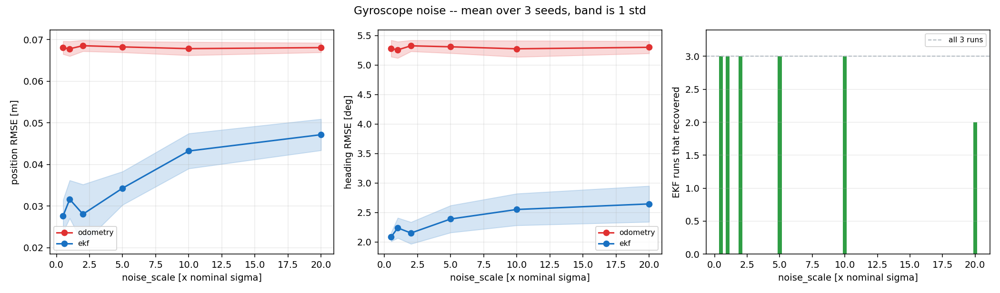
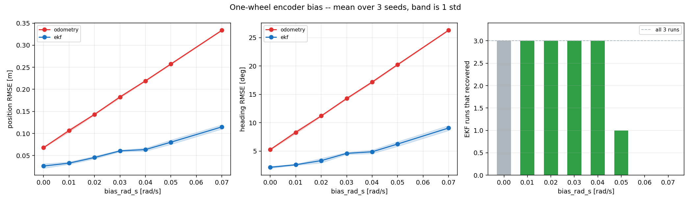
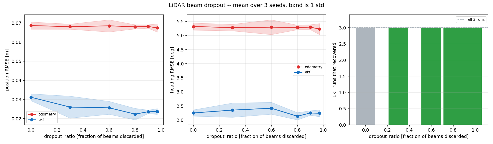
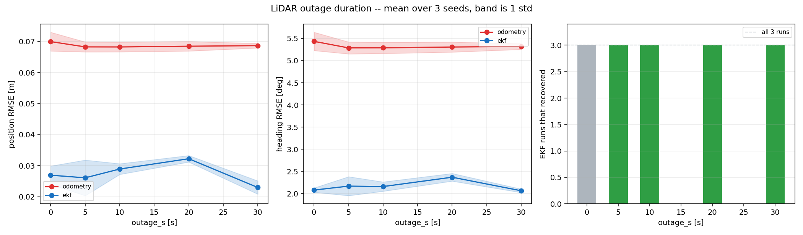
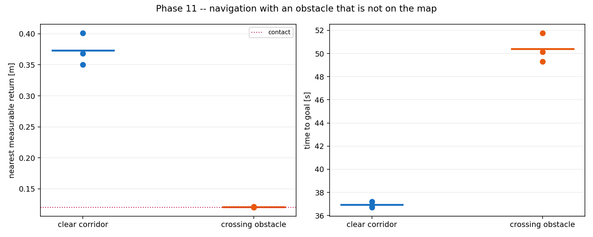

# Benchmarks

Phase 11. Five experiments, each sweeping **one** parameter across a range and
**repeated over seeds**.

Every number here comes from `results/phase11/` and is reproducible with
`scripts/run_benchmark.py` and `scripts/run_navigation_benchmark.py`.

---

## 1. What this phase is for

Phase 10 ran each failure mode **once, at one magnitude**. That answers "does
this failure mode do what the theory says". It cannot answer either of the two
questions that matter next:

* **How much can the estimator take?** A single point on a response curve does
  not tell you where the curve bends.
* **Is that an effect or is it noise?** Phase 10's Case A came out at 76 %
  covariance consistency and Case D at 92 %, and the difference was that they
  were different runs.

So: one parameter at a time, swept across a range, every point repeated over
three seeds, reported as a mean with a spread.

### The spread is a standard deviation, not a standard error

`±` throughout is the **population standard deviation over the repeats** —
how much the three runs differed from each other. It is deliberately not a
standard error or a confidence interval: three samples cannot support one, and
printing `± 0.002` as though it bounded the true mean would claim a precision
that is not there.

**Three repeats is few.** It is enough to see whether an effect is larger than
the scatter and not enough to say anything about a tail.

### Not comparable with Phase 10's numbers

These runs are 75 s where Phase 10's were 120 s. A dead-reckoning error grows
with **distance travelled**, so every absolute figure here is smaller. Within a
sweep the comparison is sound, because every run uses the same duration.

---

## 2. How one run works

```
fresh simulator -> fresh EKF -> fresh map -> fixed open-loop route
  -> one fault at one magnitude -> score against ground truth
```

The route is the rectangle Phase 5 and Phase 10 used, driven by **timed
velocity commands**. Faults are injected in the preprocessing layer, downstream
of the simulator, so the wheels receive identical commands and **the true
trajectory is the same in every run of a sweep**. Any difference in the result
is estimation error. See [fault-injection.md](fault-injection.md) section 1.

### Everything restarts between runs

Cheaper options were considered and are all wrong:

* Restarting only the sensor nodes leaves the **EKF holding the previous run's
  state** and the **mapping node holding the previous run's map**, so run N
  inherits run N-1's error — exactly the contamination the fault scheduler
  goes out of its way to avoid *within* a run.
* Seeds cannot be changed at runtime at all. The noise generators are
  constructed with their seed, and the nodes **reject** the attempt rather than
  let the parameter server disagree with the running model.

So each repeat relaunches with an overridden parameter file. The three sensor
seeds are **offset separately**, not set to a common value: giving the gyro and
the encoders the same seed correlates their noise streams, and a robot whose
gyro noise and wheel noise move together is a physically different robot from
the one every other phase measured.

---

## 3. A bug this phase found before it ran

The gyro sweep runs from **0.5x** to 20x nominal noise, deliberately covering
both ends of the response. The low end measured nothing.

`knobs_at` composed every fault against the current knob set with
`max(current, requested)`, starting from nominal. That rule exists to resolve
**two overlapping faults** — Case F's whole point — and applied between a fault
and the baseline it silently clamps anything asking for *less* than nominal:

```
max(1.0, 0.5)  ==  1.0
```

Six runs at half the datasheet noise would have measured the healthy robot and
produced a flat line at the left of every plot, which is exactly what a
diminishing-returns curve looks like. Nothing would have flagged it.

Found by generating the sweep's scenarios and **reading them before running
them**, which is worth more than two hours of simulation: a wrong number is
easier to spot in a dictionary than in a graph.

Faults now write a knob on first touch and compose only with **each other**.
The two properties pull in opposite directions, so they are tested as a pair —
one says "do not compose against nominal", the other "do compose against
another fault" — and a fix for either that broke the other would otherwise
pass.

---

## 4. Results

The generated tables and plots live in
[`results/phase11/benchmark_report.md`](../results/phase11/benchmark_report.md),
regenerated from the per-run metrics with:

```bash
python3 scripts/run_benchmark.py --aggregate-only
```

What follows is the reading of them, one experiment at a time. The per-run
JSONs under `results/phase11/raw/` are the record; the tables are a view of
them, and `--aggregate-only` re-derives every one without touching the
simulator.

---

## 4a. The filter barely notices gyro noise, and that is the point



| noise x nominal | EKF pos RMSE [m] | odom pos RMSE [m] | EKF/odom | EKF heading RMSE [deg] | inside 2-sigma |
|---|---|---|---|---|---|
| 0.5 | 0.0276 ± 0.0039 | 0.0681 ± 0.0016 | 2.46x | 2.08 ± 0.07 | 93 % |
| 1 | 0.0316 ± 0.0046 | 0.0678 ± 0.0018 | 2.14x | 2.24 ± 0.17 | 89 % |
| 2 | 0.0280 ± 0.0071 | 0.0685 ± 0.0013 | 2.44x | 2.15 ± 0.18 | 93 % |
| 5 | 0.0343 ± 0.0040 | 0.0682 ± 0.0013 | 1.99x | 2.39 ± 0.23 | 86 % |
| 10 | 0.0432 ± 0.0042 | 0.0678 ± 0.0016 | 1.57x | 2.55 ± 0.27 | 85 % |
| 20 | 0.0471 ± 0.0038 | 0.0681 ± 0.0011 | 1.44x | 2.64 ± 0.30 | 82 % |

**A 40x change in gyro noise produces a 1.7x change in position error.** That
is the Phase 10 Case B question — "does the filter down-weight a degraded
sensor, or blindly trust it?" — answered with a curve instead of a point. It
down-weights, and very effectively: the preprocessor widens the reported
covariance along with the noise, the EKF believes the gyro less, and it leans
on the encoders, which measure the same angular rate independently.

That redundancy is the whole reason `ω` is a *state* rather than an input. A
filter that took wheel odometry as a control input would have nothing to fall
back on here.

### Below 5x, buying a better gyro buys nothing

0.5x, 1x and 2x come out at 0.0276, 0.0316 and 0.0280 m — **non-monotonic and
inside the spread**. Halving the gyro noise is not measurably better than
nominal, because the gyro is not the limiting factor. The scan matcher and the
map are.

As an engineering conclusion that is worth more than the degradation curve:
*for this robot, on this route, a quieter IMU is wasted money.*

### The odometry column proves the experiment works

Wheel odometry does not consume the IMU, and its error is flat across the whole
sweep — 0.0678 to 0.0685 m, a span of 1 %. Its run-to-run spread is **±2 %**.

Two things follow. The control behaves exactly as a control should, so the
setup is measuring what it claims to. And since the EKF's spread is **±15 %**
against odometry's ±2 %, the EKF's variability is **not coming from the
sensors** — it comes from the mapping and scan-matching loop, which is the same
mechanism that produces the encoder-bias threshold below.

---

## 4b. The encoder-bias threshold is real

Phase 10 left a hypothesis it could not test. Case C (0.05 rad/s) never
recovered; Case F (0.04 rad/s) recovered in 1.4 s. Two variables differed
between those runs and each was a single sample, so it was written up as "the
experiment Phase 11 should run". This is that experiment, and the hypothesis
survives.



| bias [rad/s] | EKF pos RMSE [m] | odom pos RMSE [m] | EKF recovered | inside 2-sigma |
|---|---|---|---|---|
| 0 | 0.0262 ± 0.0051 | 0.0680 ± 0.0011 | n/a | 97 % |
| 0.01 | 0.0328 ± 0.0027 | 0.1064 ± 0.0032 | 3 / 3 | 92 % |
| 0.02 | 0.0455 ± 0.0030 | 0.1433 ± 0.0016 | 3 / 3 | 82 % |
| 0.03 | 0.0605 ± 0.0020 | 0.1827 ± 0.0023 | 3 / 3 | 68 % |
| 0.04 | 0.0635 ± 0.0034 | 0.2193 ± 0.0015 | 3 / 3 | 67 % |
| **0.05** | 0.0803 ± 0.0049 | 0.2575 ± 0.0016 | **1 / 3** | 60 % |
| 0.07 | 0.1149 ± 0.0048 | 0.3338 ± 0.0011 | **0 / 3** | 45 % |

Per-seed, the transition is sharper than the summary suggests:

```
0.01 - 0.03   never left the band          3/3   the fault is absorbed entirely
0.04          never left 2/3, recovered 1/3      the transition begins
0.05          recovered 1/3, did not 2/3         the threshold
0.07          did not recover              3/3
```

**There is a recovery threshold, and it sits between 0.04 and 0.05 rad/s** for
this route and this fault duration. Phase 10's two single runs both fall
exactly where the sweep says they should — Case C at 0.05 landing in the 2/3
that fail, Case F at 0.04 in the 3/3 that recover.

A level that comes out 1/3 is what a threshold looks like from three samples:
not a clean edge, but the point where the outcome becomes **seed-dependent**.
Where exactly it sits is not established — three seeds locate a transition
between two levels, not within one.

### The covariance consistency is the cleanest result in the project

Look at the last column. It falls **monotonically, 97 % to 45 %**, across a
sweep in which nothing about the filter changed.

This is the self-referential map quantified. As the bias grows, the drift grows
with it, and the map — built at the EKF's own estimated pose — drifts along.
Scan matching against that map keeps returning small corrections at high
scores, so the filter's reported covariance stays tight while its actual error
grows. The more **systematic** the error, the more confidently wrong the filter
becomes.

A filter whose error grows while its covariance does not is worse than a bad
filter, because everything downstream believes it. That is not visible in a
position RMSE column, which grows smoothly and unremarkably across the same
sweep.

### The spreads say these are effects, not noise

`±` at the control level is 0.0051 m on 0.0262 m — **±19 % scatter between
runs at identical conditions**. Every difference in the table above is several
times that. It also settles a Phase 10 loose end: the 76 %-vs-92 % covariance
gap between Case A and Case D there was run-to-run variation, exactly as
suspected.

---

## 4c. Eleven beams are enough

Phase 10's Case D dropped 60 % of the LiDAR beams and came out indistinguishable
from nominal, which was written up as "the scenario is not stressful" rather
than as a pass. This pushes it to 97 %.



| dropout | beams surviving | EKF pos RMSE [m] | EKF heading RMSE [deg] | inside 2-sigma |
|---|---|---|---|---|
| 0 | 360 | 0.0311 ± 0.0018 | 2.25 ± 0.11 | 89 % |
| 0.3 | 252 | 0.0260 ± 0.0058 | 2.35 ± 0.25 | 93 % |
| 0.6 | 144 | 0.0256 ± 0.0034 | 2.42 ± 0.21 | 95 % |
| 0.8 | 72 | 0.0223 ± 0.0030 | 2.14 ± 0.13 | 100 % |
| 0.9 | 36 | 0.0235 ± 0.0009 | 2.25 ± 0.08 | 98 % |
| 0.97 | **11** | 0.0237 ± 0.0015 | 2.24 ± 0.12 | 99 % |

**Throwing away 97 % of the LiDAR does not degrade the estimate.** Not
slightly — not at all.

### The fault really was applied

A null result invites the suspicion that nothing happened, so: at 0.97 the
preprocessor logged **139,546 beams dropped**, against the 139,680 predicted by
400 scans x 360 beams x 0.97. And the scan matcher kept working on what was
left — `92 accepted / 94 attempted` across the whole run, scoring 0.98.

### Why this is not surprising once you count

Eleven range returns spread around a full circle **over-determine** a 3-DOF
pose in a closed rectangular room. Scan matching against a likelihood field
does not need correspondences or features; it needs enough rays to pin down
`x`, `y` and `θ`, and three would do it in principle. At 360 beams the problem
is over-determined by two orders of magnitude.

The useful engineering conclusion is the inverse of the obvious one: **this
stack's LiDAR is massively over-specified for localisation in this
environment.** What the extra beams buy is the *map* — occupancy grid coverage
and resolution — not the pose.

### The slight improvement is real but unexplained

The trend is mildly *favourable*: 0.0311 m at no dropout against 0.0237 m at
97 %, and covariance consistency rising from 89 % to 99 %. The difference is
two to three times the run-to-run spread and consistent across every level, so
it is unlikely to be noise.

The mechanism is **not established**. A plausible one: adjacent beams hitting
the same wall are strongly correlated, the matcher treats them as independent,
and 360 of them therefore produce an over-confident match that the EKF then
over-trusts. Fewer, sparser beams would be closer to genuinely independent and
the reported covariance closer to honest — which is what the last column looks
like. Another: fewer rays integrated per scan means less reinforcement of the
current estimate in a map built at that estimate.

Both are stories that fit. Distinguishing them needs an experiment this sweep
does not contain, and it is written here as an open question rather than a
finding.

### And a limitation that matters more than the result

This is a **closed 20 x 14 m room with structure in every direction**. A
corridor with two blank parallel walls constrains one axis and leaves the other
free, and eleven beams there would be nowhere near enough. The number 11 is not
transferable; the reasoning — count the constraints against the degrees of
freedom — is.

---

## 4d. Thirty seconds without an absolute reference costs a centimetre

The LiDAR is the **only absolute** measurement in the stack. Everything else is
a rate, and rates only say how much things have changed. This sweeps how long
the filter can go without one.



| outage [s] | EKF pos RMSE [m] | degraded-phase RMSE [m] | recovered | inside 2-sigma |
|---|---|---|---|---|
| 0 | 0.0269 ± 0.0030 | -- | n/a | 95 % |
| 5 | 0.0261 ± 0.0057 | 0.0226 | 3 / 3 | 98 % |
| 10 | 0.0289 ± 0.0017 | 0.0190 | 3 / 3 | 92 % |
| 20 | 0.0322 ± 0.0010 | 0.0211 | 3 / 3 | 93 % |
| 30 | 0.0230 ± 0.0021 | 0.0216 | 3 / 3 | 99 % |

Every run recovers, and the whole-run RMSE does not move outside the spread.
The degraded-phase column rises monotonically from 10 s onwards — 0.0190,
0.0211, 0.0216 — which is the effect, and it is about **2 mm**.

### The outage is real; this was checked

A second null result in the same phase deserves more suspicion than the first,
so the knob was exercised against a live stack and the scan matcher counted
directly:

```
outage ON,  20 s elapsed:   0 new matches attempted
outage OFF, 20 s elapsed:  23 new matches attempted
```

Scan matching stops completely. The preprocessor logged 213 scans dropped over
the same window.

### Why it costs so little, in a number from Phase 4

During an outage the EKF is not on raw wheel odometry — it is on **odometry
fused with the gyroscope**, which Phase 4 measured at **0.13 % of distance
travelled** against raw odometry's 0.94 %.

At 0.25 m/s a 30 s outage is 7.5 m, so the drift added while blind is
`0.0013 x 7.5 = 0.010 m`. Against a baseline error of about 0.02 m, a
centimetre is exactly what the table shows. The result is not a surprise; it is
the Phase 4 number applied for thirty seconds.

That is also the argument for fusing the gyro rather than treating wheel
odometry as a control input, stated as a consequence rather than a principle:
**it is what makes the absolute reference optional for half a minute.**

### The route flatters this, and the honest number is smaller

The lap is 30.5 s. A 30 s outage is therefore almost exactly **one closed
lap**, and the robot ends it back where it started, so part of the
dead-reckoning position error cancels rather than accumulating.

A 30 s outage on a straight 7.5 m traverse would show more. The mechanism
above still applies and the conclusion survives, but the specific number
0.0216 m is the best case, not the typical one.

---

## 5. The fifth experiment tests the planner, not the estimator

Four sweeps degrade a **sensor**. The last one degrades the **world**: an
obstacle crosses the corridor the robot is driving down, and it is not on the
map.

Each seed is run **twice** — once with the obstacle and once without — and the
pairs compared. An absolute arrival time means little on its own, because the
route is replanned as the map fills in and no two runs take quite the same
path. The *difference* between a paired run is what the obstacle cost.

Three things about the obstacle are deliberate and each was a wrong turn first:

* **It is spawned into the running world, not written into the floor plan.**
  An obstacle present at startup is mapped on the way past, and A* simply
  routes around it — that tests the costmap and nothing about reacting.
* **It is a model with collision geometry, not a Gazebo `<actor>`.** Actors are
  the obvious tool and are visual-only by default: no collision, so the LiDAR
  sees straight through them. An obstacle a sensor cannot detect tests nothing.
* **It is teleported each tick, not velocity-controlled.** Teleporting makes
  its trajectory an exact function of simulated time, so it repeats identically
  across seeds. A velocity-controlled model accumulates its own integration
  differences, the robot meets it somewhere slightly different every run, and
  the one thing that must be identical across repeats becomes another source of
  variance.

Its true pose is published as **instrumentation** and falls under the same
isolation rule as ground truth and the fault state: a local planner *told*
where an obstacle is, rather than seeing it, is solving a different and much
easier problem.

### Results: the local planner walks into it, every time



| metric | clear corridor | crossing obstacle |
|---|---|---|
| runs | 3 | 3 |
| arrived (within 0.30 m) | **3 / 3** | **0 / 3** |
| touched the obstacle (ground truth) | 0 | **3 / 3** |
| runs with a beam inside `range_min` | 0 | 3 |
| time to goal [s] | 36.9 ± 0.2 | 50.4 ± 1.0 |
| distance driven [m] | 16.94 ± 0.03 | 18.12 ± 1.48 |
| nearest measurable return [m] | 0.373 ± 0.021 | 0.121 ± 0.001 |
| **true obstacle clearance [m]** | -- | **−0.230 ± 0.022** |
| final error [m] | 0.298 ± 0.001 | 2.035 ± 2.216 |

A negative clearance is an overlap. The robot and the obstacle occupied the
same space by 23 cm, in **every run**.

Two of the three still ended up near the goal (0.45 m and 0.49 m) and stopped
themselves believing they had arrived — the localisation-limited arrival
accuracy already documented in Phase 9, made worse by the collision. One ended
5.17 m away. None scored as arrived against a 0.30 m tolerance, but "0 / 3
arrived" overstates it: the honest statement is **0 / 3 within 0.30 m, 2 / 3
within 0.5 m, 3 / 3 collided.**

### Why: DWA plans against a still photograph

The trace says it plainly.

```
   t    clearance   v_cmd   v_true
17.3       0.354    0.492    0.492     full speed, corridor looks clear
17.5       0.245    0.453    0.460
17.7       0.118    0.441    0.444
17.8       0.027    0.000    0.433     <- FIRST stop command
17.9      -0.023    0.000    0.328     already overlapping
```

DWA does not command a stop until the clearance is **0.027 m**. At that instant
it is travelling 0.437 m/s and needs `v²/2a = 0.096 m` to stop. It has 0.027 m.
The collision was unavoidable a second earlier.

It is not that the planner was careless — it is that **DWA has no model of
obstacle velocity**. Its rollout sweeps a trajectory forward through the
*current* obstacle positions and rejects anything that intersects them. A
crossing obstacle is not in the swept volume when the rollout is computed; it
walks into that volume afterwards. Each 50 ms cycle the planner re-computes,
correctly, that the path ahead is clear — of where the obstacle *was*.

The admissible-velocity condition `v ≤ √(2·d·a_max)` is doing its job exactly
as designed. `d` is the distance to collision **assuming the world holds
still**, and that assumption is what fails.

The real fix is not a tuning change. It is velocity obstacles (or RVO), or a
costmap layer that inflates along an obstacle's *predicted* motion — both of
which require estimating obstacle velocity. That was built next, and §5b is
what happened when it was measured.

### The experiment also has a flaw, and it is worth stating

The obstacle sweeps `y ∈ [−1.1, +1.1]` **forever**, and the corridor is 3 m
wide. It is less a pedestrian crossing than a **moving wall the robot cannot
wait out**. A real crossing — one traverse, then gone — would let a planner
that simply stopped and waited succeed, and this design gives it no such
option.

The mechanism above is unaffected: DWA reacted at 0.027 m because it had no
velocity model, and it would have done the same on a single traverse. But
"0 / 3 arrived" is partly a property of the course, not only of the planner.

---

## 5b. Measuring the fix, and three ways an experiment can lie

An obstacle tracker and a prediction rule were added to fix §5. Asking
whether they worked took four attempts, and the first three measured
nothing. None of them failed — that is the point of this section.

### The baseline was not a baseline

The sweep built its control arm like this:

```bash
ros2 launch arb_planning planning.launch.py predict_obstacle_motion:=false
```

The launch file never declared that argument. **ros2 launch accepts an
undeclared `name:=value`, discards it, and exits zero.** No warning. The run
proceeds on the YAML default and is indistinguishable from a configured one.
Every "no prediction" run predicted, and the two arms were one configuration
sampled twice.

Verified by asking the node rather than reading the file: launched with
`:=false`, `ros2 param get /local_planner predict_obstacle_motion` answers
**True**.

The accident was worth something. Two arms differing in *nothing* gave
110 ± 36 s and 140 ± 56 s — so a difference of that size is not a difference.
Against the pre-tracker baseline of 50.4 ± 1.0 s on the same course, it also
says that adding the tracker made the robot slower **and far less
predictable**.

### Nothing controlled the encounter

The obstacle's phase was anchored to the instant its spawn call returned,
which waits on `/clock`, on Gazebo, and on a service round trip. The comment
above it claimed the motion "repeats identically in every run". It did not.

Whether the robot *meets* the obstacle depends entirely on that phase. The
same seed and the same binary produced a clean 39.6 s arrival and a 180 s
timeout with 0.39 m of overlap. The phase is now anchored to the simulation
clock and exposed as `phase_offset_s`, so the encounter is swept across one
full period and the arms are compared **in matched pairs** — which is what
makes a dozen runs enough.

### One run's simulator survived into the next

`ros2 launch` starts a ruby wrapper which starts `gz sim`. Teardown signals
the wrapper; the wrapper dies and logs it; the grandchild can live on, and
then shares a world and a transport with the next run while neither log says
so. One orphan was caught by hand. **The sweep before it therefore cannot be
proven clean**, and its numbers are reported with that caveat rather than
dropped. The harness now refuses to start beside a stray and reports what
teardown leaves behind.

### What the measurement says

Twelve matched encounters per sweep, phase swept across one full period.

| | tracker as built | with the aperture rule |
|---|---|---|
| mean movers reported (**one** exists) | 2.37 | **1.66** |
| runs reporting more than 2 | 7 / 12 | **3 / 12** |
| reached the goal | 5 / 12 | **7 / 12** |
| no contact | 6 / 12 | **8 / 12** |
| mean clearance | +0.009 m | **+0.057 m** |

The aperture rule (§ *Extent cannot tell a small object from a small piece
of a big one*, [control.md](control.md)) is a real improvement and **not a
cure**: 1.66 phantoms in a world with one object means sources remain.

On the question the experiment was built to answer:

| | reached goal | mean clearance |
|---|---|---|
| treat obstacles as stationary | **4 / 6** | **+0.149 m** |
| predict obstacle motion | 3 / 6 | −0.035 m |

Prediction has **never been ahead in aggregate**, in either sweep. With six
pairs per arm the gap is not separable from the spread, so the honest
statement is not "prediction is worse" but **"there is no evidence it
helps, and some that it hurts."**

The cause is upstream, and the correlations say so plainly:

| predictor of reaching the goal | before the rule | after |
|---|---|---|
| phantom rate | r = **−0.73** | r = −0.48 |
| the prediction setting under test | r = −0.17 | r = −0.17 |

Whether the planner predicts matters less than whether the tracker is
telling it the truth. So `predict_obstacle_motion` now defaults to **false**.
The feature and its 34 tests stay; what is switched off is trusting it in
the field, until the phantom rate approaches 1.0.

That is the useful shape of this result. The work was not wasted — it built
the tracker, the aperture rule, a paired experiment and three guards against
experiments that lie. What it did not do is earn the feature a place in the
default configuration, and saying so is cheaper than discovering it later.

---

## 5c. Fixing the tracker, and what that uncovered

§ 5b left the tracker reporting 1.76 moving obstacles in a world containing
one. Three rules brought that to 0.99. The method was the point: **count
before changing anything.**

The tracker now records births, matches, deaths, splits, merges, speed
rejections and how long dead tracks lived. That census disproved the
hypothesis it was built to test — the phantoms were not short-lived noise.
Dead tracks had lived 36 cycles on average and 34 of 42 had been *trusted*.
Merges outnumbered splits two to one. Their extents sat either side of the
real obstacle's 0.40 m, which ruled out size as the discriminator and
pointed at shape.

| rule | discriminator |
|---|---|
| **shape** | deviation from a fitted line per unit length — a wall is locally straight at any width, a cylinder cannot be |
| **association** | globally nearest pair first; ambiguous pairings associate but yield no velocity |
| **staleness** | a velocity unconfirmed for 0.4 s stops counting as motion |

Each was measured on its own, four runs apiece:

| rule set | movers | peak | tracks created | merges |
|---|---|---|---|---|
| aperture only | 2.21 | 9 | 375 | 2387 |
| + shape | 1.72 | 6 | 114 | 814 |
| + association | 1.92 | 5 | 96 | 415 |
| + staleness | **0.68** | **2** | **37** | **149** |

Association alone **raised** the headline number while improving every
structural counter, which is how the next bug was found: better matching
keeps tracks alive longer, and freezing the velocity of an ambiguous track
meant a spurious velocity, once acquired, outlived every chance to disprove
it.

### The result over the full sweep

Twelve runs, the same six crossing phases as § 5b:

| | aperture only | all three rules |
|---|---|---|
| mean movers (**one** exists) | 1.76 | **0.99** |
| peak | 7 | **4** |
| cycles reporting more than two | 30 % | **4 %** |
| reached the goal | 7 / 12 | 7 / 12 |
| **passed without contact** | **8 / 9** | **5 / 9** |
| mean clearance, travelled runs | +0.149 m | +0.055 m |

The tracker is now honest, and the robot hits things more often.

That is not a contradiction. A planner dodging obstacles that are not there
is a cautious planner: it slows, it swings wide, and it misses the real
obstacle as a side effect of missing everything. Remove the phantoms and it
drives the route it was always asked to drive — into the crossing obstacle
§ 5 measured it colliding with in 3 of 3 runs. **The phantoms had been an
accidental safety margin, and the Phase 11 defect was never fixed, only
masked.**

Nine travelled runs cannot separate 5/9 from 8/9 with confidence, so the
magnitude is suggestive rather than established. The direction is the
finding: a correct component made the system worse, because the system had
come to depend on the incorrect one.

`predict_obstacle_motion` therefore stays **off**. Prediction has not been
ahead in aggregate in any sweep, and with the tracker telling the truth the
remaining collisions belong to the planner, not its input.

---

## 6. What these sweeps cannot tell you

* **Three seeds.** Enough to see whether an effect exceeds the scatter, not
  enough to characterise a distribution or a worst case.
* **One parameter at a time.** Interactions are exactly what Phase 10's Case F
  was for, and a sweep of one axis says nothing about them. The honest reading
  of Case F remains that its outcome was dominated by its strongest component.
* **One environment.** Every run is in the same 20 x 14 m world from the same
  spawn. A sparser environment would change the LiDAR results substantially —
  a likelihood field has far less to lock onto in a corridor with two
  featureless walls.
* **The simulator's sensor models are idealised.** Absolute figures are
  meaningful relative to each other, not as predictions of real hardware.
