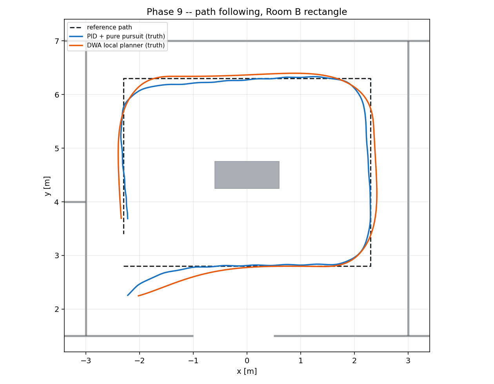
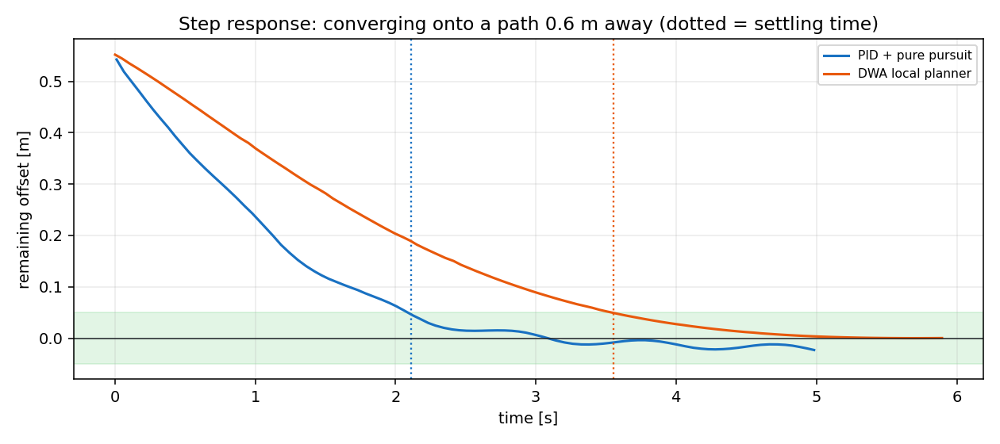
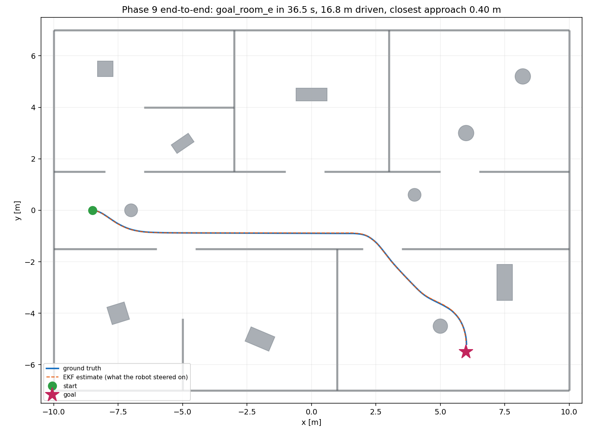

# Local Obstacle Avoidance and Control

Phases 8 and 9. Two controllers, both turning a global path into wheel
commands, measured against each other on the same course.

Every number here comes from `results/phase9/` and is reproducible with
`scripts/evaluate_navigation.py`.

---

## 1. Two controllers, one topic

`arb_planning/local_planner_node` (DWA) and `arb_control/controller_node`
(pure pursuit + PID) both publish `/cmd_vel`. They are **alternatives, not
companions** — two publishers on a command topic is a robot that does neither
thing. `planning.launch.py local_planner:=false` disables one so the other can
run.

They differ in what they are allowed to know:

| | DWA local planner | PID path follower |
|---|---|---|
| Sees obstacles | yes, from the live scan | **no** |
| Search space | velocities `(v, ω)` | none — geometry, then two PID loops |
| Handles a moving obstacle | yes | drives through it |
| Tracking accuracy | slightly worse | slightly better |
| Command smoothness | **11× smoother** | busy |

The PID follower exists as the **baseline**: without it there is no way to say
what DWA's obstacle avoidance costs in tracking accuracy, because there is
nothing to compare against.

---

## 2. Pure pursuit, and the bug it hides

A pure-pursuit controller aims at a **carrot**: the point a fixed arc length
further along the path than the robot's own projection onto it.

```
  1. project the robot onto the path  -> nearest point, arc length s
  2. carrot = the point at arc length s + lookahead
  3. steer at the carrot
```

Step 1 is the one that gets skipped. Walking `lookahead` metres from the path's
**first vertex** looks identical for the first second of every run, because at
t = 0 the robot *is* at the path's first vertex. It then stops being identical,
and the carrot never advances.

This project shipped that bug **twice, independently**, in two controllers
written days apart:

| | symptom |
|---|---|
| PID follower | drove to a carrot 0.35 m from the path's start, passed it, then aimed at a point behind itself. Turned at its maximum rate for 150 s. |
| DWA planner | covered **1.99 m of a 15.60 m course in 140 s**; the best-scoring command every cycle was the slowest the window allowed |

Both had a comment claiming the carrot was measured "from the robot". Both
passed their unit tests. They passed because **every test rebuilt the path
around the robot each step** — a path that slides along with the robot makes
vertex 0 and the projection the same point forever, which is exactly the
condition under which the bug is invisible.

It is also the condition the global planner creates: it replans from the
robot's current position every second. So the defect hid behind the replanner
in normal operation and surfaced only when a path was held still.

The fix was to move the geometry into
[`arb_core/path_geometry.hpp`](../ros2_ws/src/arb_core/include/arb_core/path_geometry.hpp)
— one implementation, one test suite, and a dependency direction that does not
make the planner depend on the controller. The test that catches it holds the
path **fixed in the world** and transforms it into the robot frame each step
(`Follower.CarrotAdvancesAlongAPathFixedInTheWorld`,
`Dwa.MakesProgressAlongAPathFixedInTheWorld`).

### Progress is monotonic

`projectOntoPath(path, from)` will not search segments before `from`. Without
it, a path that comes back near itself — a lap, a corridor walked twice — lets
the projection snap to a leg finished ten metres ago, and the cross-track error
it reports then has the **wrong sign**, so the controller steers away from the
path it is on. The window is one robot length backwards, so a robot that slips
can still recover.

---

## 3. PID, and the two things that make it a real controller

`Pid::update` is thirty lines. Two of them are what separate it from the
textbook formula.

### Anti-windup

If the output saturates — and it always does, because actuators have limits —
the integrator keeps accumulating an error the robot cannot act on. By the time
the error reverses, the integrator holds a large value that must be unwound
before the output leaves saturation. The result is a long overshoot that looks
like a tuning problem and is not.

Two defences: the integral **term** is clamped (in output units, so the limit
means the same thing whatever `ki` is), and it stops accumulating entirely
while the output is saturated in the direction the error would push it further:

```cpp
const bool pushing_further =
  (would_saturate_high && error > 0.0) || (would_saturate_low && error < 0.0);
if (!pushing_further) { integral_ = candidate_integral; ... }
```

### The derivative of an angle is not the difference of two angles

The angular channel tracks a heading error, which wraps. A heading error that
slides from −3.12 rad to +3.10 rad has changed by **0.06 rad**, not by 6.22.
Differentiating the raw difference reports +124 rad/s² where the truth is +1.2.

One such spike saturates the output. And because a robot turning one way always
wraps the same way, **the spike always has the same sign** — it reinforces the
rotation that produced it. Measured, before `error_is_angle` existed: the robot
turned at its limit continuously while the heading error cycled through every
value, and no error signal could stop it.

---

## 4. The rate limiter must not be anchored to the measurement

This one cost the most to find, because the symptom is identical to a tuning
problem.

A velocity command is rate-limited so the actuator is never asked for a step it
cannot take. The question is *rate-limited from what*.

Anchoring it to the **measured** velocity feeds the plant's own overshoot back
into the limiter. Gazebo's wheel controller settles about 11 % above a commanded
2.0 rad/s, so:

```
  measured ω   = 2.22 rad/s
  admissible   = [2.22 − 0.15, 2.22 + 0.15] = [2.07, 2.37]
  absolute cap = [−2.00, 2.00]
```

The admissible band lies **entirely above the cap**. Clamping any request into
it returns 2.07 — including a request of −2.0 — and the final clamp yields
exactly 2.0. Commanding 2.0 keeps the measurement at 2.22. The loop is closed
and nothing inside it can open it: **2.0 rad/s commanded for 117 consecutive
seconds** on a course the robot was supposed to be tracking.

The anchor is now the **previous command**. It is known exactly, is always
inside the limits, and produces a command sequence whose slew rate is what it
claims to be. The measured velocity keeps the jobs it should have: the linear
PID's feedback, and the speed-scaled lookahead. `follow()` no longer takes a
measured ω at all.

A consequence worth noting: with the command as the anchor, the **order** of
the rate clamp and the absolute clamp provably does not matter (the previous
command already satisfies the absolute limit, so the two clamps commute). The
mutation harness confirms no test can distinguish them, and it is right not to
— that is an equivalent mutant, not a gap.

---

## 5. DWA

The Dynamic Window Approach searches **velocities**, not positions, so every
candidate is by construction something the robot can do. See
[`dynamic_window.hpp`](../ros2_ws/src/arb_planning/include/arb_planning/dynamic_window.hpp)
for the full derivation. Four objective terms, normalised before weighting:

| term | what it wants | alone, it |
|---|---|---|
| heading | end the rollout pointing at the carrot | drives into walls |
| clearance | stay far from obstacles | parks in the largest open space |
| velocity | go fast | drives flat out into the first thing it meets |
| path | end the rollout near the carrot | — |

### Admissible velocity, not a clear horizon

The naive safety rule — reject any command whose rollout hits something — is
far too strict: a robot with 0.45 m of room at 0.3 m/s finds no admissible
command and stops dead. The right condition is that the robot can **stop**
before what it can see:

```
  v ≤ sqrt(2 · d · a_max)
```

The same condition now also applies to the **goal**, with `d` the arc length
remaining along the path. Nothing in the objective knows the path ends, so
without it the robot runs at its limit until the arrival check fires and stops
dead — it reaches the goal by overshooting and being told to halt, which is not
arriving.

Distance is measured **along the path**, never as the straight line. On a path
that turns back, the straight line shrinks while there are still metres to
drive, and the robot would crawl the whole way round.

### Collision checking steps by distance, not time

Stepping the rollout by time at 0.66 m/s and 0.1 s jumps 6.6 cm between checks,
and the resolution then depends on speed. Measured that way, the planner
reported 0.265 m of room where there was 0.20 m. It now steps by arc length and
rounds down.

---

## 6. Measured

`scripts/evaluate_navigation.py --mode tracking` publishes a known reference
path directly to `/arb/global_path` and records what the robot does. The global
planner and the map are deliberately out of the loop: a controller measured
behind a planner is measured together with the planner's replanning jitter.

The robot starts **0.6 m off the path on purpose**. That offset is a step
input, and a step is the only input for which "settling time" and "overshoot"
have agreed definitions.

Course: a three-cornered 15.60 m open rectangle in Room B, with at least 0.37 m
of wall clearance and 1.45 m to the nearest crate — the PID follower has *no*
obstacle avoidance, so it is being measured on tracking, not on luck.



| metric | unit | PID + pure pursuit | DWA |
|---|---|---|---|
| completed the course | | yes | yes |
| time | s | **25.6** | 32.0 |
| mean speed | m/s | **0.559** | 0.444 |
| cross-track RMSE (steady) | m | **0.084** | 0.085 |
| worst steady error (a corner) | m | 0.249 | **0.222** |
| settling time, 0.6 m step | s | **2.11** | 3.55 |
| overshoot | % | 4.24 | **0.00** |
| heading error RMSE (steady) | rad | **0.270** | 0.297 |
| command smoothness, linear | m/s² | 0.766 | **0.173** |
| command smoothness, angular | rad/s² | 2.514 | **0.234** |
| steering sign changes | | 40 | **2** |
| EKF error inherited | m | 0.130 | 0.039 |
| closest approach to anything | m | 0.534 | 0.459 |
| collision-free | | yes | yes |



**Reading it.** The two controllers are within 1 mm of each other on
steady-state tracking accuracy and differ enormously everywhere else.

* PID converges **1.4 s faster** but with 4 % overshoot and visible
  oscillation — it turns in place to face the path, then drives.
* DWA converges monotonically with **zero overshoot**, because it arcs onto the
  path instead of turning first, and because its velocity window cannot produce
  a step.
* DWA's command stream is **11× smoother in the angular channel** and changes
  steering direction **2 times** against PID's 40. Tracking error alone would
  call these controllers equivalent; nothing in the error metrics shows that one
  of them is sawing at its wheels.
* The "EKF error inherited" row is the floor under everything else: a controller
  can only be as accurate as its estimate of where it is. DWA's is lower partly
  *because* it drives more smoothly — scan matching works better when the robot
  is not jerking.

`--mode recompute` re-derives every metric and plot from the saved samples
without touching the simulator. The CSVs are the record of what the robot did;
the metrics are a reading of them, and the settling window changed three times
before it meant anything.

---

## 7. End to end

`scripts/evaluate_navigation.py --mode goal` runs the whole stack: simulator →
sensors → EKF + scan matching → mapping → A* → DWA → wheels. One goal, no human
in the loop.



| | `goal_far_east` | `goal_room_e` |
|---|---|---|
| arrived (ground truth, 0.30 m) | yes | yes |
| time | 36.9 s | 36.5 s |
| distance driven | 16.92 m | 16.77 m |
| straight-line distance | 17.00 m | 15.51 m |
| path efficiency | 1.005 | 0.925 |
| final error | 0.299 m | 0.300 m |
| EKF error at arrival | 0.084 m | 0.040 m |
| closest approach | 0.365 m | 0.401 m |
| collision-free | yes | yes |

`goal_room_e` is the harder one: down the corridor swinging south of the pillar
at (−7, 0), through the 1.5 m doorway at x ∈ [2.0, 3.5], into Room E and around
the drum at (5, −4.5). The planner is run with `unknown_is_lethal:=false`
because the robot has not explored the corridor yet — a planner that refuses to
enter unknown space cannot produce a plan at all from a cold start. It replans
at 1 Hz as the map fills in, and the local planner is what keeps it honest
about what is actually there.

**Arrival accuracy is limited by localization, not by control.** The stack stops
when it *believes* it has arrived within 0.20 m; whether it has is a question
about the EKF. One run stopped 0.32 m from the goal believing it was 0.25 m
closer than that, and `stopped_itself_short` in the metrics records exactly
that case.

---

## 8. What is not here

* **No recovery behaviours.** A robot that gets genuinely stuck stays stuck.
  Production stacks rotate, back up, clear the costmap and retry.
* **No dynamic obstacles yet.** DWA takes its obstacles from the live scan
  precisely so it can handle them; Phase 11 is where that gets measured.
* **The PID follower cannot avoid anything.** That is deliberate — it is the
  baseline — but it must never be the only controller on a real robot.
* **Corner cutting.** Both controllers drive ~14.2 m of a 15.60 m course. A
  lookahead that cuts corners is the price of not weaving on straights; the
  trade is set by `lookahead_min_m` and `lookahead_gain_s`.
