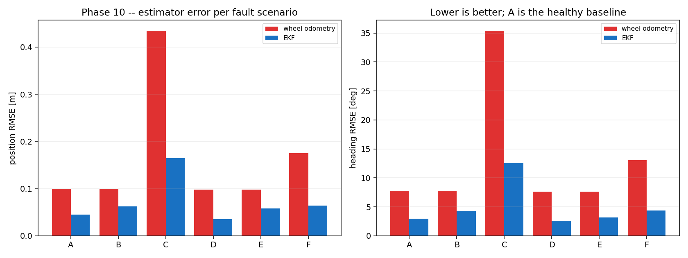
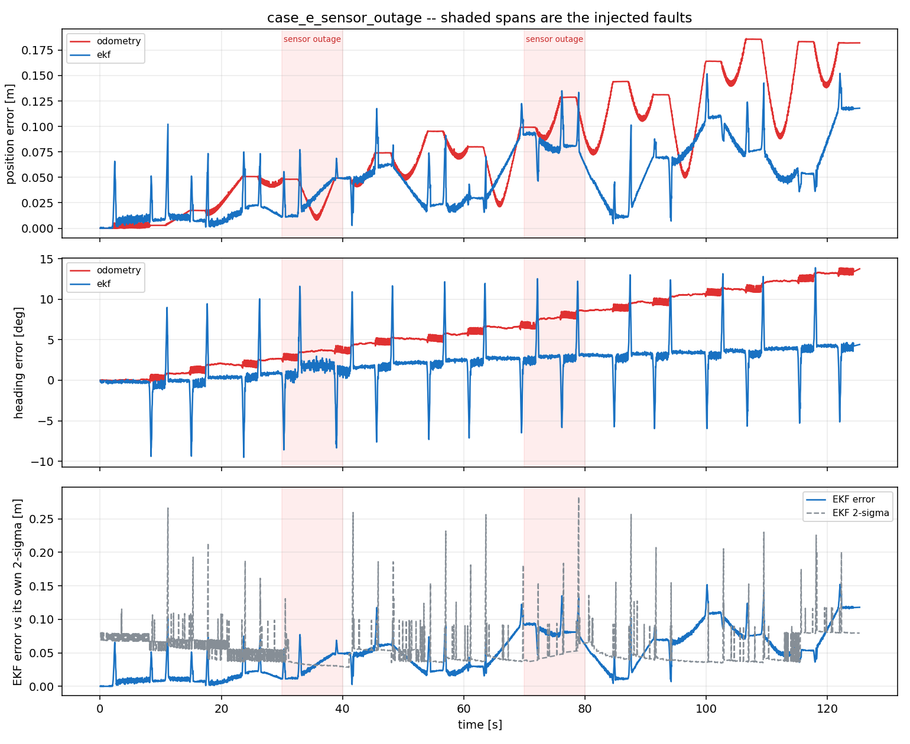

# Fault Injection

Phase 10. Six scenarios, one estimator, and the question of what a filter does
when its sensors stop telling the truth.

Every number here comes from `results/phase10/` and is reproducible with
`scripts/run_scenario.py` followed by `scripts/fault_report.py`.

---

## 1. Where a fault is injected, and why it matters

Faults are applied in the **sensor preprocessing layer** — `arb_sensors` — not
in the simulator:

```
Gazebo  --raw-->  arb_sensors  --processed-->  EKF / mapping / planning
                       ^
                       |  fault.* parameters, set at runtime
                  fault_scheduler
```

That placement is the whole experiment. The wheels receive the same commands in
every scenario and the simulator knows nothing about the fault, so **the true
trajectory is identical across all six cases**. Any difference between Case A
and Case C is estimation error and nothing else.

Injecting inside Gazebo instead would change the physics, the robot would
physically drive somewhere different, and the resulting error would confound
estimation quality with trajectory difference — with no way to separate them
afterwards.

The same reasoning forces an **open-loop route**. The robot is driven by timed
velocity commands, never towards a goal. A closed-loop route would steer on the
corrupted estimate and destroy the property the comparison rests on.

---

## 2. The three pieces

| Piece | Where | What it is |
|---|---|---|
| Knob timeline | `arb_evaluation/scenario.py` | A **pure function** of (scenario, time). No ROS. |
| Scheduler | `arb_evaluation/fault_scheduler.py` | Reads the clock, calls parameter services, publishes `FaultState`. |
| Runner + scorer | `scripts/run_scenario.py` | Drives the route, records, scores. |

The split is deliberate. `knobs_at(scenario, t)` being pure is the only reason
the timeline is testable at all: asserted against a running simulator, a wrong
ramp and a slow parameter service look exactly the same. It has 56 unit tests
and 13 injected mutations, all caught.

### Sim time, not wall time

Gazebo's `real_time_factor` is uncapped so batch experiments run fast, and this
world runs well above 1.0. A scheduler on wall time would apply a fault
declared for t = 20 s at whatever simulated instant happened to coincide, the
robot would be somewhere different every run, and Case A would not be a
baseline for anything.

### Polling, not a precomputed schedule

A list of edges is tempting and wrong: an encoder bias **ramps continuously**
over five seconds, so there is no finite set of instants at which the correct
value changes. Polling at `rate_hz` makes the ramp's resolution explicit rather
than hidden.

### Composition, not file order

Faults overlap — that is the point of Case F. Where two touch the same knob the
**stronger wins**: a multiplier takes the larger factor, a bias the larger
magnitude, an outage wins outright. File order is not a physical property and
must not decide what the robot experiences.

---

## 3. The six cases

| Case | Scenario | The question it asks |
|---|---|---|
| A | Nominal | The baseline every other case is measured against |
| B | IMU noise x10 from 20 s | Does the filter **down-weight** a degraded sensor, or keep trusting it? |
| C | Right-wheel bias, ramped to 0.05 rad/s | A one-wheel bias **is a turn** as far as the encoders can tell |
| D | 60 % LiDAR beams dropped, bursty | Does the NIS gate **reject** a scan match computed from too few beams? |
| E | Total IMU outage 30-40 s, LiDAR outage 70-80 s | Does the filter keep **predicting** and re-converge, or freeze? |
| F | Encoder drift + 5x IMU noise + 30 % dropout, overlapping | Individually survivable faults **compounding** |

### Every fault clears before the scenario ends

Each fault stops 25 s before the run does. The first version of these files ran
every fault to the last second, which made **recovery time** — one of the three
numbers this phase exists to report — unmeasurable for four of the six cases:
there was simply no interval in which the sensors were healthy again.
`test_every_scenario_with_a_fault_leaves_a_recovery_window` now enforces the
tail.

### Case C is the nasty one

A constant bias on one wheel is **indistinguishable from a genuine turn** using
encoders alone. Dead reckoning curves away silently and consistently — there is
no residual, no disagreement, nothing to detect. Only an independent heading
source (the gyro) or an absolute one (LiDAR scan matching) can catch it, and
that is exactly why the EKF fuses both.

The bias **ramps** over five seconds rather than stepping. A step is easy to
detect and is rarely how hardware fails: a loosening wheel coupling or a warming
MEMS element degrades over seconds, and there is no single instant at which
something obviously changed.

---

## 4. What is measured

**Position RMSE** and **heading RMSE**, each split three ways — the healthy
phase before the first fault, the degraded phase, and the recovered phase after
the last fault clears. A single number over a run that was healthy for a third
of it says nothing about either half.

**Recovery time**: seconds from the last fault clearing until the position
error is back inside the band it held *while healthy in that same run*, and
**stays** there for 3 s. A single sample dipping under the threshold is noise.

The band is measured against the run's own healthy phase, not against Case A.
Two runs differ by more than the noise floor for reasons that have nothing to do
with the fault — physics seeds, where the map happened to be built — and a
threshold taken from a different run would make recovery time an artefact of
that difference.

The result is reported with an **outcome**, not just a number: `no fault`,
`no post-fault window`, `never left the band`, `recovered`, `did not recover`.
Collapsing "there was no fault" and "it recovered instantly" both to 0.0 would
make them indistinguishable in the table.

### The phase split is confounded with distance, and the table says so

A dead-reckoning estimator's error grows with **distance travelled**, not with
the fault. Wheel odometry does not consume the IMU at all, yet its Case B
numbers still read healthy 0.011 m, degraded 0.084 m, recovered 0.154 m — that
is drift accumulating over four laps, not a response to a fault it cannot see.

So the phase split is a **diagnostic, not a comparison**. Two comparisons are
sound and the table is built from them:

* **EKF vs odometry within one case** — same run, same distance, same
  trajectory, and only one of the two can see the fault.
* **Each case's EKF against Case A's** — same route, same duration, same total
  distance, differing only in what was injected. This is the `vs A` column.

Odometry is in the table as a **control**: it shows what the phase split looks
like for an estimator the fault provably cannot touch.

### Every number here is ONE run

No scenario is repeated and nothing is averaged over seeds. Two runs of the
*same* scenario differ by more than a little: the physics seed, where the robot
happened to be when the map filled in, and which scan matches landed all move
the result. Case A's covariance consistency came out at 76 % and Case D's at
92 %, and that gap is run-to-run variation, not an effect of dropping 60 % of
the LiDAR beams.

So: read a **2x change as real** and anything smaller as noise. Phase 11's
benchmark sweep is where repetition and averaging belong; this phase is about
whether each failure mode does what the theory says, and the ones that matter
here move the error by 4-10x.

**Covariance consistency**: the fraction of samples whose error fell inside the
filter's own reported 2-sigma. This is the difference between a filter that
degrades and one that **lies**. A filter whose error grows while its covariance
stays tight is worse than a bad filter, because everything downstream believes
it.

---

## 5. Results

Regenerate with `python3 scripts/fault_report.py`; the tables below are copied
from `results/phase10/summary.md`.



### EKF

| Case | Scenario | Position RMSE [m] | vs A | Heading RMSE [deg] | vs A | Degraded-phase pos. RMSE [m] | Recovery [s] | Inside 2-sigma |
|---|---|---|---|---|---|---|---|---|
| A | Nominal | 0.0452 | 1.00x | 2.97 | 1.00x | -- | n/a | 76 % |
| B | IMU noise x10 | 0.0621 | 1.37x | 4.30 | 1.45x | 0.0535 | 14.9 | 65 % |
| C | Encoder drift | 0.1646 | 3.64x | 12.54 | 4.22x | 0.1162 | **never** | 47 % |
| D | LiDAR dropout 60 % | 0.0352 | 0.78x | 2.60 | 0.88x | 0.0332 | not perturbed | 92 % |
| E | Sensor outage 10 s | 0.0578 | 1.28x | 3.20 | 1.08x | 0.0647 | 0.9 | 56 % |
| F | Multi-degradation | 0.0644 | 1.43x | 4.38 | 1.47x | 0.0544 | 1.4 | 70 % |

### Wheel odometry — the control

| Case | Scenario | Position RMSE [m] | vs A | Heading RMSE [deg] | vs A | Degraded-phase pos. RMSE [m] | Recovery [s] | Inside 2-sigma |
|---|---|---|---|---|---|---|---|---|
| A | Nominal | 0.1000 | 1.00x | 7.76 | 1.00x | -- | n/a | 100 % |
| B | IMU noise x10 | 0.0994 | 0.99x | 7.75 | 1.00x | 0.0838 | **never** | 100 % |
| C | Encoder drift | 0.4351 | 4.35x | 35.43 | 4.56x | 0.3688 | **never** | 67 % |
| D | LiDAR dropout 60 % | 0.0976 | 0.98x | 7.60 | 0.98x | 0.0842 | **never** | 100 % |
| E | Sensor outage 10 s | 0.0977 | 0.98x | 7.60 | 0.98x | 0.0818 | **never** | 100 % |
| F | Multi-degradation | 0.1747 | 1.75x | 13.10 | 1.69x | 0.1562 | **never** | 100 % |

### Reading it

**The EKF beats dead reckoning in every case**, by 1.5x to 2.8x on position.
That is the whole argument for fusing at all, measured.

**Faults the encoders cannot see do not move the odometry column.** Cases B, D
and E come out at 0.98-1.00x of nominal for wheel odometry, because none of them
touches a wheel encoder. That column is behaving exactly as a control should,
and it is how you can tell the phase split is reading drift rather than damage.

**The failure modes rank in the order the theory predicts.** An encoder bias
(C, 3.6x) is far worse than gyro noise (B, 1.4x), which is worse than a total
sensor outage (E, 1.3x), which is worse than losing most of the LiDAR beams
(D, no measurable effect). What makes a fault dangerous is not how much signal
it destroys but whether anything else can contradict it.

**Odometry is always inside its own 2-sigma and the EKF often is not.** Wheel
odometry reports a covariance that grows without bound, so it is trivially
consistent — and useless, because a bound that wide constrains nothing. The EKF
makes a much tighter claim and is wrong about it between 8 % and 53 % of the
time. That is the honest reading: **this filter is overconfident**, most of all
in Case C where it asserts +/-0.31 degrees while being wrong by 12.

---

## 5a. Case F did not compound, and the reason is a lead worth chasing

Case F runs three faults at once and comes out at **1.43x** nominal — *milder
than Case C's 3.64x*, which is one fault. It also **recovered in 1.4 s** where
Case C never recovered at all.

Compounding is not what happened. The outcome was dominated by the single
strongest component, and **Case F's encoder bias is the weaker one**:

| | Case C | Case F |
|---|---|---|
| wheel | right | left |
| bias | 0.05 rad/s | 0.04 rad/s |
| window | 15-95 s | 20-95 s |
| heading RMSE after the fault cleared | 20.9 deg | 6.9 deg |
| recovered | no | **yes, 1.4 s** |

So a 20 % smaller bias over a 6 % shorter window is the difference between a
map the scan matcher can pull the estimate back onto and one it cannot. That
suggests a **threshold** in the self-referential map: below some accumulated
drift the map stays good enough to recover from, and above it the map has been
redrawn around the error.

Stated as a hypothesis, not a result. Two variables differ between C and F and
each is a **single run**, so this is not an attribution — it is the experiment
Phase 11 should run: one fault, magnitude swept, repeated over seeds.

---

## 6. Case C defeats the stack, and the reason is worth the whole phase

Case C is the one that does not end well, and the diagnosis is more useful than
a pass would have been.

| | odometry | EKF |
|---|---|---|
| position RMSE | 0.435 m | **0.165 m** |
| heading RMSE | 35.4 deg | **12.5 deg** |
| position RMSE *after the fault cleared* | 0.657 m | 0.279 m |
| heading RMSE *after the fault cleared* | 54.1 deg | 20.9 deg |
| recovered? | **no** | **no** |
| error inside its own 2-sigma (heading) | 41 % | **13 %** |

The EKF cuts the error by 2.6x versus dead reckoning, and **neither recovers**.
Worse, both are further off *after* the fault clears than during it.

The logs say exactly why:

```
scan match: 253 accepted / 253 attempted (0 rejected) |
            last score 0.963, correction 0.014 m 0.23 deg
EKF: 1-sigma pos=0.018 m heading=0.31 deg | odom 6447/6464 fused (319 gated)
```

The filter believes its heading to **±0.31 degrees while being wrong by 12**.
The scan matcher accepts every match, scores them 0.96+, and applies
corrections of a centimetre.

**The map is built at the EKF's estimated pose.** As the estimate drifts, the
map drifts with it, and scan matching against that map then *confirms* the
drifted pose with high confidence. There is no external reference anywhere in
the loop — the absolute correction is only absolute relative to something the
estimate itself drew.

The NIS gate is working: `319 gated` odometry measurements are the biased ones
being rejected. It cannot help, because the alternative reference is corrupted
in the same direction.

This is the cost of the limitation the README has stated since Phase 6 — a
static occupancy grid with **no loop closure and no pose-graph optimisation**.
Case C is what that costs when the drift is systematic rather than random. The
fix is not a better filter; it is SLAM with loop closure, or a landmark the
robot did not draw itself.

---

## 7. Case E is the one the filter passes cleanly

Case E asks the question an EKF exists to answer: with **no measurement at
all**, does it keep predicting and re-converge, or freeze?

It keeps predicting, and re-converges in **0.91 s**.



The two bands are the outages. The asymmetry between them is the interesting
part:

* **IMU outage, 30-40 s** — barely visible. Wheel odometry and scan matching
  are both still there, and the gyro's contribution is heading rate, which the
  encoders also measure.
* **LiDAR outage, 70-80 s** — the error climbs to 0.09 m and the reported
  2-sigma (bottom panel, dashed) **grows smoothly throughout the outage**, from
  0.03 m to 0.05 m. That growth is the filter correctly saying "I have no
  absolute reference and I am getting less sure". When the scan returns the
  error snaps back down.

The LiDAR matters more because it is the **only absolute** measurement. Everything
else is a rate, and rates only ever tell you how much things have changed.

Covariance consistency is the blemish: 56 % of samples inside 2-sigma, the worst
of any case. The filter survives the outage and is honest *during* it, and is
still too confident overall.

---

## 8. A knob that could not do what the config claimed

`configs/scenarios/*.yaml` declares `affect_accelerometer` per IMU fault: Case B
degrades the whole package, Case F only the gyro. The preprocessor had a single
`fault.noise_scale` that scaled **both** channels, so that setting was a comment
rather than a setting — Case F degraded the accelerometer anyway and nothing
said so.

`fault.accel_noise_scale` now exists separately. It cannot change the pose
estimate, and that is the point: **the EKF does not fuse the accelerometer at
all**. For a planar robot at walking pace the useful signal is buried under
gravity leakage from millidegree chassis tilt, and integrating it twice to get
position is strictly worse than the wheel encoders. Case B measures that claim
rather than asserting it.

A config value that is silently ignored is worse than no config value.

---

## 9. What is not tested here

* **No fault detection.** Nothing in the stack decides a sensor has failed and
  acts on it. The NIS gate rejects individual bad measurements, which is not the
  same thing as noticing that a sensor is broken and reconfiguring around it.
* **No sensor recovery logic.** After an outage the filter simply resumes
  fusing. A real system would re-check calibration before trusting the sensor
  again.
* **Faults are injected downstream of the simulator**, so they cannot model a
  fault that changes the physics — a slipping wheel, a dragging brake. Those
  would need the simulator itself to change.
