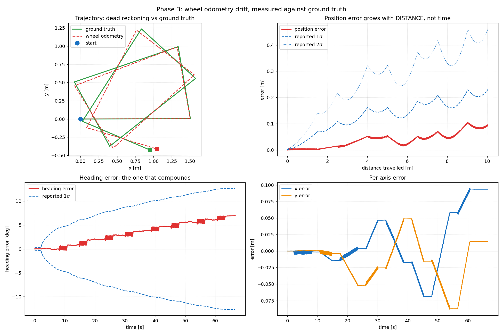
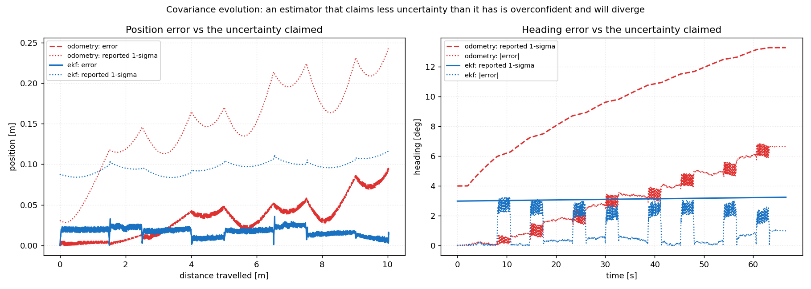

# State Estimation

> Phases 3–5, all complete and measured.

## 1. Differential-drive kinematics

Two wheels of radius `r`, a distance `L` apart, rolling without slipping. Each
contact point moves at `v = r * omega_wheel`. The body is rigid, so both share
one angular velocity:

```
v_r = v + omega * L/2          v     = (v_r + v_l) / 2 = r (omega_r + omega_l) / 2
v_l = v - omega * L/2   ==>    omega = (v_r - v_l) / L = r (omega_r - omega_l) / L
```

A differential drive cannot move sideways, so the body-frame velocity is always
`(v, 0, omega)` and

```
x_dot = v cos(theta),   y_dot = v sin(theta),   theta_dot = omega
```

## 2. Exact arc integration

Forward Euler (`x += v cos(theta) dt`) assumes the heading is constant over the
step and therefore always cuts the corner while turning. The error is
systematic, not random: a robot driving in a circle spirals inwards.

With `v` and `omega` constant over the step the path is a circular arc, and the
exact update follows from the sum-to-product identities with `a = omega * dt`:

```
x     += v dt * sinc(a/2) * cos(theta + a/2)
y     += v dt * sinc(a/2) * sin(theta + a/2)
theta += a
```

with `sinc(u) = sin(u)/u`, `sinc(0) = 1`. This is the exponential map of SE(2)
applied to the body twist, so it is exact rather than merely accurate. It has
no singularity at `omega = 0`, uses the midpoint heading (second-order
accuracy), and the `sinc` factor is precisely the chord-to-arc ratio.

Implementation: `arb_localization/src/differential_drive_odometry.cpp`.

## 3. Covariance propagation

```
P <- Fx P Fx' + Fu Q Fu'
```

`Q` is diagonal in wheel-arc space and proportional to `|arc|`: a wheel that
slips does so in proportion to how far it turned, so variance is linear in
distance and standard deviation grows as `sqrt(distance)`. The two wheels are
independent, which is the only reason heading uncertainty grows at all.

`Fu` includes the derivative of the `sinc` factor. The textbook Jacobian omits
it because the textbook update is the midpoint approximation, which has no
`sinc` to differentiate. Integrating exactly and differentiating the
approximation leaves `F` inconsistent with `f`, measured here as a 0.045 %
disagreement with a central finite difference — small, systematic, and exactly
what makes an EKF quietly overconfident.

Both Jacobians are verified against central finite differences in
`test_odometry.cpp`.

## 4. Calibration: L is not a geometric measurement

The URDF says the wheels are 0.350 m apart, and it is right — that is where
their centre planes are. The physics disagrees, because a cylindrical wheel
touches the floor along a **line**, and the traction that turns the robot does
not act at the centre plane.

Measured with `scripts/calibrate_odometry.py` (three full turns in each
direction, direction asymmetry 0.00 %):

| Parameter | Geometric | Calibrated | Difference |
|---|---|---|---|
| Track width `L` | 0.3500 m | **0.3154 m** | −9.90 % |
| Wheel radius `r` | 0.06000 m | 0.05997 m | −0.05 % |

0.3154 m is the distance between the wheels' **inner edges**
(0.350 − 0.035 = 0.315 m) to within a millimetre.

Effect on a 10 m route of two rectangle laps:

| Metric | Geometric `L` | Calibrated `L` |
|---|---|---|
| Final position error | 0.989 m (9.86 % of distance) | **0.095 m (0.94 %)** |
| Final heading error | −72.36° | **6.96°** |
| RMS position error | 0.540 m | **0.055 m** |

A tenfold improvement from one number. A systematic error is not noise, and no
Kalman filter removes a bias it has not been told about — which is why this is
fixed in Phase 3 rather than tuned around in Phase 4.

On real hardware, where ground truth is unavailable, the standard substitute is
UMBmark (Borenstein & Feng, 1996): drive a square clockwise and anticlockwise
and solve the same two unknowns from the pattern the end-point errors make.

## 5. Where the residual error lives



The heading-error trace is a staircase: it steps at every turn and is flat on
every straight. After calibration roughly 0.87° remains per 90° turn. Straight
running contributes almost nothing.

This is the measurement that motivates Phase 4. Dead reckoning has no absolute
reference, so its uncertainty can only grow; an independent heading source (the
gyro) bounds the rate of growth, and an absolute source (LiDAR scan matching
against the map) bounds the error itself.

## 6. Frames

```
map --(EKF correction: slow, DISCONTINUOUS)--> odom --(odometry: fast, SMOOTH)--> base_link
```

`arb_localization/wheel_odometry` publishes `odom -> base_link` only. The
`map -> odom` correction belongs to the EKF. Writing a correction into
`odom -> base_link` destroys the smoothness controllers depend on, and is the
most common way to break a ROS navigation stack.


---

## 7. The Extended Kalman Filter (Phase 4)

### State vector

```
x = [ x, y, theta, v, omega, b_gyro ]^T
```

| State | Why it is there |
|---|---|
| `x, y, theta` | the pose, which is what everything downstream wants |
| `v, omega` | the body twist. **Two independent sensors measure these**: the encoders measure both, the gyroscope measures `omega`. Making them states is what lets the filter fuse the two opinions. Treating odometry as a control input instead throws the gyro's information away — and Phase 3 measured that the entire residual error lives in rotation. |
| `b_gyro` | the gyroscope's slowly varying zero offset. Integrated for `t` seconds it produces `b*t` of heading error, without bound. It is **observable** here precisely because the encoders measure `omega` independently: the persistent gap between the two readings is the bias. |

Deliberately absent:

* **`v_y`** — a differential drive is non-holonomic and cannot translate
  sideways, so `v_y` is identically zero. Adding it creates a state no
  measurement constrains; the covariance grows without bound along that
  direction and the position smears. An unobservable state is not free.
* **accelerometer bias** — the accelerometer is not in the measurement model at
  all. For a planar robot at walking pace the signal is buried under gravity
  leakage from millidegree chassis tilt, and double-integrating it is strictly
  worse than the encoders. It is published, logged, and not believed.

### Measurement models

| Source | `z` | `h(x)` | `R` from |
|---|---|---|---|
| Wheel odometry | `[v, omega]` | `[v, omega]` | the twist covariance in `nav_msgs/Odometry` |
| IMU gyroscope | `omega_meas` | `omega + b_gyro` | `angular_velocity_covariance` |
| Scan match (Phase 6) | `[x, y, theta]` | `[x, y, theta]` | the matcher's covariance |

The gyro's `h` includes the bias. That is the whole reason the bias is
estimable: the filter attributes the persistent gap between gyro and encoders
to `b` rather than repeatedly dragging `omega` towards a biased reading.

### Numerical choices that matter

* **Joseph form** for the covariance update. `(I - K H) P (I - K H)' + K R K'`
  is a sum of two positive semi-definite terms, so symmetry and definiteness
  survive rounding. The textbook `(I - K H) P` is a difference of two positive
  quantities; with a prior of `1e6` and `R = 1e-14` it produces a posterior
  variance around `2e-10`, four orders of magnitude above `R` and of arbitrary
  sign.
* **Chi-square innovation gating** on the NIS. An EKF has no other defence
  against a wrong measurement, and a bad correction makes the next measurement
  look even more wrong. The gate is forced open after a long run of rejections,
  because a gate that never yields traps a filter that is genuinely lost.
* **Process noise scales as `dt`, not `dt^2`.** See below.

### Two defects found by running it

**Process noise scaled as `dt^2`.** A velocity driven by white acceleration is
a random walk: its variance accumulates as `q*T`, independent of the step size.
Writing the per-step variance as `(sigma*dt)^2` gives `sigma^2*T*dt`, which
*shrinks* as the step shrinks — the same filter at 200 Hz comes out four times
more confident than at 50 Hz.

| | accumulated `sigma_v` over 20 ms |
|---|---|
| `(sigma*dt)^2`, 5 ms steps | 0.008 m/s |
| `sigma^2*dt` (correct) | 0.113 m/s |

The platform accelerates at 1.0 m/s², so `v` changes by 0.020 m/s between 50 Hz
odometry updates. Under the wrong scaling that arrived as a 2.5-sigma
measurement and the gate rejected it. The filter held `v = 0.08 m/s` while the
robot pivoted in place against an odometry reading of 0.0001 m/s, tracing a
half-metre loop at every corner. Position RMSE was 0.298 m — six times worse
than the odometry it was supposed to improve.

**Multi-rate fusion dropped almost every odometry message.** The IMU runs at
200 Hz and the odometry at 50 Hz; whichever callback fires advances the filter
clock past the other sensor's newest stamp. Measured: 1917 IMU updates against
3 odometry updates in ten seconds. The filter was running on the gyroscope
alone, which makes the gyro bias unobservable — the exact state the six-state
design exists to estimate.

The fix is a timestamp-ordered measurement buffer with a 60 ms window. A second
defect hid behind the first: Gazebo publishes on a 1 ms physics grid, so the
two streams share a timestamp exactly every fourth sample, and treating "not
strictly newer" as out-of-order discarded all of those. `dt == 0` is a valid
case that needs an update without a prediction.

After both fixes: `odom 467/470 fused, imu 1833/1845 fused, out-of-order 0`.

## 8. Results (Phase 5)

Two laps of a 1.5 x 1.0 m rectangle, 10.03 m travelled:

| Metric | Wheel odometry | EKF | Change |
|---|---|---|---|
| Position RMSE | 0.0486 m | **0.0155 m** | **−68.0 %** |
| Position mean | 0.0393 m | 0.0139 m | −65 % |
| Position max | 0.0949 m | 0.0358 m | −62 % |
| Final position error | 0.0946 m (0.94 %) | **0.0134 m (0.13 %)** | −86 % |
| Heading RMSE | 3.631° | **1.432°** | **−60.6 %** |
| Heading max | 6.811° | 3.225° | −53 % |
| Final heading error | +6.626° | **+0.977°** | −85 % |
| Reported final 1σ (position) | 0.2436 m | 0.1175 m | — |
| Reported final 1σ (heading) | 13.26° | 3.23° | — |
| Samples inside reported 2σ | 100 % | 100 % | — |

Estimation latency: median 55 ms, p95 60 ms, max 70 ms — the cost of the
measurement buffer, measured rather than hidden.



The odometry's error and its claimed uncertainty both grow without bound. The
EKF's error stays flat and its uncertainty grows very slowly: the gyro bounds
the *rate* at which heading uncertainty accumulates. It does not bound the
position error itself, because the filter still has no absolute measurement.
That arrives in Phase 6, when a map exists to match scans against.
