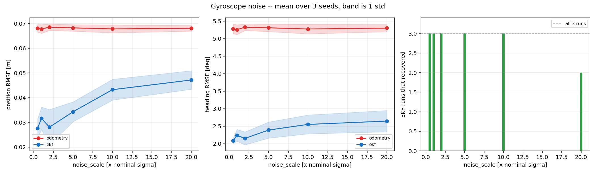
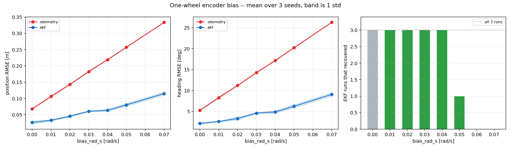
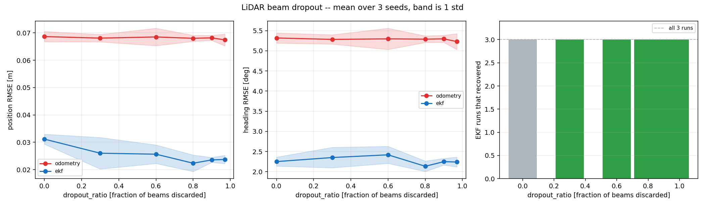
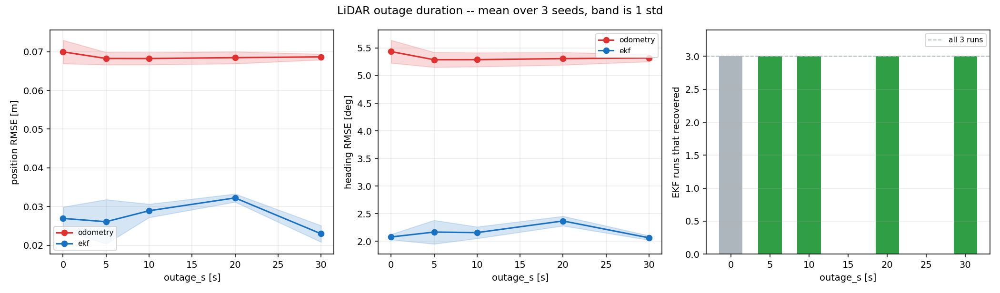

# Phase 11 — benchmark sweeps

Every point is the mean over 3 seeds; `±` is the population standard deviation across them, not a standard error — three samples cannot support a confidence interval.

Run length 75 s, spawn `odometry_test`, open-loop route. These numbers are NOT directly comparable with Phase 10's 120 s runs: a dead-reckoning error grows with distance travelled.

## Gyroscope noise

How much gyro noise can the filter absorb before it stops beating dead reckoning? Covers both the low-noise and high-noise ends in one sweep, which shows the shape of the response rather than two points on it.

| noise_scale [x nominal sigma] | runs | EKF pos RMSE [m] | odom pos RMSE [m] | EKF heading RMSE [deg] | EKF recovered | EKF inside 2-sigma |
|---|---|---|---|---|---|---|
| 0.5 | 3 | 0.0276 ± 0.0039 | 0.0681 ± 0.0016 | 2.08 ± 0.07 | 3 / 3 | 93 % |
| 1 | 3 | 0.0316 ± 0.0046 | 0.0678 ± 0.0018 | 2.24 ± 0.17 | 3 / 3 | 89 % |
| 2 | 3 | 0.0280 ± 0.0071 | 0.0685 ± 0.0013 | 2.15 ± 0.18 | 3 / 3 | 93 % |
| 5 | 3 | 0.0343 ± 0.0040 | 0.0682 ± 0.0013 | 2.39 ± 0.23 | 3 / 3 | 86 % |
| 10 | 3 | 0.0432 ± 0.0042 | 0.0678 ± 0.0016 | 2.55 ± 0.27 | 3 / 3 | 85 % |
| 20 | 3 | 0.0471 ± 0.0038 | 0.0681 ± 0.0011 | 2.64 ± 0.30 | 2 / 3 | 82 % |

## One-wheel encoder bias

The experiment Phase 10 could not run. Case C (0.05 rad/s) never recovered and Case F (0.04 rad/s) recovered in 1.4 s, but those two runs differed in more than magnitude and each was a single sample. Sweeping the magnitude alone, repeated over seeds, is what decides whether there is a recovery threshold or whether that was noise.

| bias_rad_s [rad/s] | runs | EKF pos RMSE [m] | odom pos RMSE [m] | EKF heading RMSE [deg] | EKF recovered | EKF inside 2-sigma |
|---|---|---|---|---|---|---|
| 0 | 3 | 0.0262 ± 0.0051 | 0.0680 ± 0.0011 | 2.15 ± 0.17 | n/a | 97 % |
| 0.01 | 3 | 0.0328 ± 0.0027 | 0.1064 ± 0.0032 | 2.60 ± 0.10 | 3 / 3 | 92 % |
| 0.02 | 3 | 0.0455 ± 0.0030 | 0.1433 ± 0.0016 | 3.32 ± 0.40 | 3 / 3 | 82 % |
| 0.03 | 3 | 0.0605 ± 0.0020 | 0.1827 ± 0.0023 | 4.60 ± 0.19 | 3 / 3 | 68 % |
| 0.04 | 3 | 0.0635 ± 0.0034 | 0.2193 ± 0.0015 | 4.88 ± 0.31 | 3 / 3 | 67 % |
| 0.05 | 3 | 0.0803 ± 0.0049 | 0.2575 ± 0.0016 | 6.25 ± 0.41 | 1 / 3 | 60 % |
| 0.07 | 3 | 0.1149 ± 0.0048 | 0.3338 ± 0.0011 | 9.07 ± 0.43 | 0 / 3 | 45 % |

## LiDAR beam dropout

Phase 10's 60 % dropout was indistinguishable from nominal, because 40 % of 360 beams is still 144 and a likelihood field does not need many. This pushes it to where it does matter.

| dropout_ratio [fraction of beams discarded] | runs | EKF pos RMSE [m] | odom pos RMSE [m] | EKF heading RMSE [deg] | EKF recovered | EKF inside 2-sigma |
|---|---|---|---|---|---|---|
| 0 | 3 | 0.0311 ± 0.0018 | 0.0686 ± 0.0019 | 2.25 ± 0.11 | n/a | 89 % |
| 0.3 | 3 | 0.0260 ± 0.0058 | 0.0681 ± 0.0014 | 2.35 ± 0.25 | 3 / 3 | 93 % |
| 0.6 | 3 | 0.0256 ± 0.0034 | 0.0685 ± 0.0032 | 2.42 ± 0.21 | 3 / 3 | 95 % |
| 0.8 | 3 | 0.0223 ± 0.0030 | 0.0680 ± 0.0011 | 2.14 ± 0.13 | 3 / 3 | 100 % |
| 0.9 | 3 | 0.0235 ± 0.0009 | 0.0682 ± 0.0009 | 2.25 ± 0.08 | 3 / 3 | 98 % |
| 0.97 | 3 | 0.0237 ± 0.0015 | 0.0674 ± 0.0022 | 2.24 ± 0.12 | 3 / 3 | 99 % |

## LiDAR outage duration

The LiDAR is the only ABSOLUTE measurement in the stack; everything else is a rate, and rates only say how much things have changed. This sweeps how long the filter can go without one and still come back.

| outage_s [s] | runs | EKF pos RMSE [m] | odom pos RMSE [m] | EKF heading RMSE [deg] | EKF recovered | EKF inside 2-sigma |
|---|---|---|---|---|---|---|
| 0 | 3 | 0.0269 ± 0.0030 | 0.0700 ± 0.0030 | 2.08 ± 0.05 | n/a | 95 % |
| 5 | 3 | 0.0261 ± 0.0057 | 0.0683 ± 0.0016 | 2.17 ± 0.21 | 3 / 3 | 98 % |
| 10 | 3 | 0.0289 ± 0.0017 | 0.0682 ± 0.0016 | 2.16 ± 0.11 | 3 / 3 | 92 % |
| 20 | 3 | 0.0322 ± 0.0010 | 0.0685 ± 0.0015 | 2.37 ± 0.09 | 3 / 3 | 93 % |
| 30 | 3 | 0.0230 ± 0.0021 | 0.0687 ± 0.0007 | 2.06 ± 0.04 | 3 / 3 | 99 % |
